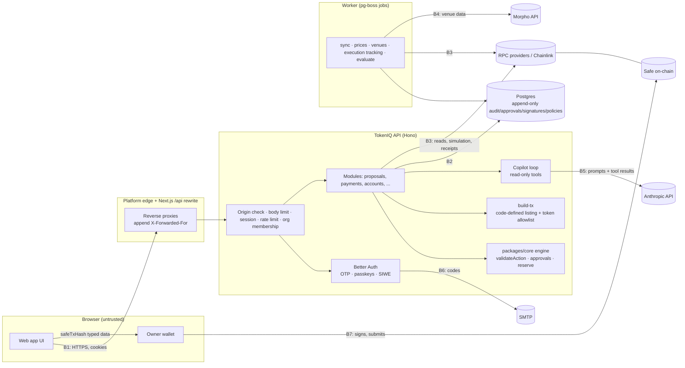

# TokenIQ 2.0 threat model (backend)

> Internal security review by an AI-assisted engineering process. **Not an independent third-party audit.**
> Scope: `apps/api`, `packages/core`, `packages/chain`, `packages/db` as of 2026-10-11. The web app is covered only where
> it shapes a backend boundary (CSP, Markdown rendering). Contract-level threats are in
> [`packages/contracts/REVIEW.md`](../packages/contracts/REVIEW.md) and [`CONTRACT_REVIEW.md`](CONTRACT_REVIEW.md).
> Findings referenced as BE-xx are in [`BACKEND_REVIEW.md`](BACKEND_REVIEW.md).

## 1. What TokenIQ protects

| Asset | Why it matters | Where it lives |
|---|---|---|
| Treasury funds in organizations' Safes | The ultimate target. TokenIQ never holds keys, but it builds the calldata owners sign | On-chain; calldata built in `apps/api/src/services/build-tx.ts` |
| Integrity of proposals, approvals and Safe signatures | Approvers and signers rely on TokenIQ's figures, policy checks and approval state | `proposals`, `approvals`, `safe_signatures`, `executions` tables |
| Integrity of treasury figures (reserve, deployable surplus, payment status) | Policy checks for real allocations are computed from them | `packages/core` engine; `balance_snapshots`, `payments`, `price_observations` |
| Tenant isolation | Organizations see only their own treasury, obligations, documents and conversations | Every org-scoped query filters by `organization_id`; org middleware in `apps/api/src/app.ts` |
| Identities and sessions | Session cookies grant role-based powers inside organizations | Better Auth (`apps/api/src/auth.ts`), `sessions` table |
| Audit trail | Evidence of who did what; append-only | `audit_events` (trigger in `packages/db/migrations/0001_append_only_guards.sql`) |
| Uploaded documents and copilot conversations | Confidential business data | `obligation_documents`, `copilot_threads/messages` |
| Secrets | `BETTER_AUTH_SECRET`, SMTP, Anthropic and RPC keys | Environment, validated by `apps/api/src/env.ts` |

## 2. Actors

| Actor | Capabilities | Trust |
|---|---|---|
| Anonymous internet user | Reach `/api/auth/*`, `/api/health`, `/api/status`, `/api/v1/meta` | Untrusted |
| Signed-in user with no membership | Create organizations and sample workspaces, accept invitations addressed to their email | Untrusted toward other organizations |
| Member: viewer | Read the organization, export reports, use the copilot | Trusted to read only |
| Member: approver | Approve or reject, submit Safe signatures, record executions | Partially trusted (insider) |
| Member: finance | Create obligations, payments and proposals; manage accounts | Partially trusted (insider). The main insider threat for policy bypass |
| Member: admin / owner | Manage members and policies | Highly trusted inside the organization; can still be a single rogue actor |
| Safe owners | Sign the exact transaction in their own wallets | Final authority over funds; TokenIQ cannot override them |
| External data sources | RPC providers, Chainlink feeds (via RPC), Morpho API, Anthropic API, SMTP | Semi-trusted: data is validated; addresses never come from them |
| The language model (copilot) | Calls read-only tools with the requester's organization fixed by the server | Untrusted output; can be steered by injected text |
| Platform operators | Database, environment, deploys | Trusted (out of scope) |

## 3. Trust boundaries

| Boundary | Crossing | Main controls |
|---|---|---|
| B1 Browser → API | Every request | HTTPS, `SameSite=Lax` + `HttpOnly` + `Secure` (prod) cookies, origin check on every non-GET `/api/v1/*` and `/api/auth/*` (`app.ts`), Hono `csrf()` for form types, no CORS grants, 6 MB body limit, per-user rate limit, org membership middleware returning 404 to non-members |
| B2 API → database | Every query | Parameterised Drizzle queries; `organization_id` on every org row and query; unique indexes for idempotency, one decision per member, one transfer per settlement; append-only triggers |
| B3 API/worker → RPC | Safe state, balances, simulation, receipts, signature verification | Reads pinned to `latest − confirmations`; chain id checks; addresses from code; owners re-read before signing and execution; execution tracked by the Safe's own event and `safeTxHash` |
| B4 Worker → Morpho API | Venue metrics | Asset must be on the token allowlist; listing decided by code (`isListed`); calldata never uses API addresses |
| B5 API ↔ LLM | Prompts, tool results, model output | Tools are read-only and bound to the requester's org; user/external text wrapped as `untrusted_text`/`untrusted_json`; per-user hourly limit; max 6 tool rounds; output rendered without HTML, links or images |
| B6 API → SMTP | Codes, invitations, critical alerts | Codes hashed at rest, 5 attempts per code, per-email send/attempt limits |
| B7 Wallet → chain | Owners sign `safeTxHash` themselves | Wallet shows typed data; Safe enforces threshold and nonce; TokenIQ stores signatures but holds no keys |

## 4. STRIDE per boundary

### B1 Browser → API

| STRIDE | Threat | Mitigation (code) | Residual |
|---|---|---|---|
| Spoofing | Stolen or replayed session cookie | `HttpOnly`, `Secure` (prod), `SameSite=Lax`, 7-day expiry (`auth.ts`) | Cookie cache lets a revoked session work for up to 60 s (BE-15, accepted) |
| Spoofing | OTP brute force | 6 digits, 5 attempts per code, codes stored hashed; per-email send (5/15 min) and attempt (10/15 min) limits (`app.ts`, BE-06) | Limits are per instance, in memory |
| Spoofing | SIWE replay / cross-site / expired message | Nonce consumed before verification, domain/expiry/not-before checked by Better Auth and `viem/siwe`; chain id must match (`auth.ts`) | Signature verification trusts the RPC for smart-account signatures (BE-18) |
| Tampering | CSRF on JSON, multipart or auth routes | Origin/Referer allowlist on every non-GET `/api/v1/*` and `/api/auth/*`; `csrf()` for form types; no CORS | — |
| Repudiation | Members deny actions | Every state change writes `audit_events` in the same transaction with actor, IP (resolved via `TRUSTED_PROXY_COUNT`), user agent | IP is spoofable if `TRUSTED_PROXY_COUNT` is unset |
| Info disclosure | Cross-organization reads (IDOR) | Membership middleware; every query filters by org; non-members get 404 (`app.ts`, all modules); verified by the cross-org sweep test | — |
| Info disclosure | Error details | `onError` returns codes and request ids only; RPC errors are not echoed on 500s | Some 4xx/422 messages include the first line of an RPC error (`accounts.ts`) |
| DoS | Request floods, header-rotation bypass of IP limits, shared-bucket lockout behind proxies | Per-user API limit; client IP from the trusted hop (`lib/rate-limit.ts`) passed to Better Auth; body limit | In-memory limits per instance; unauthenticated limit depends on `TRUSTED_PROXY_COUNT` |
| Elevation | Role escalation (admin → owner), approver creating proposals | Server-side permission matrix (`lib/authz.ts`), `canAssignRole`, last-owner rule under row locks (BE-10) | A single admin can weaken policies (BE-16) |

### Financial pipeline (inside the API)

| STRIDE | Threat | Mitigation | Residual |
|---|---|---|---|
| Tampering | Finance member states a small `amountUsd` but a large `assetAmountRaw` to pass reserve checks and land in a low approval tier | `validateAction` binds the two within 1% (`amount_consistent`, `packages/core/src/actions.ts`, BE-01) | — |
| Tampering | Payment proposal to an attacker address or in another asset/network | Recipient, network and asset must match the obligation's recorded terms (`recipient_matches`, BE-02) | Finance can edit the payee first (BE-17) |
| Tampering | Malformed actions (hex, negative, > uint256, unknown types) | Strict Zod schema (`ActionInput`, `modules/proposals.ts`, BE-08) | — |
| Tampering | Approval races (double decision, stuck proposals) | Unique `(proposal_id, user_id)`; row lock on the proposal while deciding (BE-03) | — |
| Tampering | Signatures for another hash, from non-owners, replayed after re-prepare, forged v=1 | Recovery against the stored `safeTxHash`; owner check against a fresh on-chain read; counted only for the current hash; v=0/1 refused (`packages/chain/src/safe.ts`) | — |
| Tampering | Executing a cancelled proposal | Status machine refuses prepare/sign/execute after cancel | Collected signatures stay valid on-chain until the nonce moves (BE-11) |
| Tampering | Unsafe call targets | build-tx uses only the code listing, the token allowlist and the Aave pool; every receiver is the Safe; CALL-only builders | — |
| Tampering | One transfer "verifies" many obligation occurrences | Unique `(org, chain, tx, log index)` per settlement (BE-05) | Sender need not be an org account (BE-26) |
| Repudiation | Disputed approvals/signatures | Append-only triggers on approvals, signatures, audit, policies | DB owner role could drop triggers (BE-31) |
| DoS | Another org squats a public tx hash to block tracking | Execution uniqueness per proposal (BE-04) | — |

### B3 RPC, B4 Morpho API

| STRIDE | Threat | Mitigation | Residual |
|---|---|---|---|
| Spoofing | Fake Safe contract reporting arbitrary owners | Only affects the organization that added it; verification needs an owner signature; typed data is domain-bound to the Safe address | Verification proves control of one owner key, not the Safe's authenticity |
| Tampering | Malicious RPC lies about owners, nonce, balances, receipts or ERC-1271 results | Dedicated RPCs recommended; reads pinned; chain id checked; owners' wallets compute what they sign | Public fallback RPCs are used if the dedicated one fails; a lying RPC can corrupt figures and verification (BE-18) |
| Tampering | Morpho API returns hostile names/addresses/metrics | Addresses from code; names wrapped as untrusted for the copilot; metrics drive suitability only | Inflated liquidity/TVL could loosen policy checks for listed venues (accepted) |
| Info disclosure | RPC URLs with keys in errors | 500s are generic; stored sync errors keep the first line only | — |
| DoS | Provider outage | Provider health tracking, stale data marks treasury incomplete and blocks proposals (fail closed) | — |

### B5 Copilot

| STRIDE | Threat | Mitigation | Residual |
|---|---|---|---|
| Tampering | Prompt injection via titles, notes, labels, venue names, alerts, audit data | All free text wrapped as untrusted data, system prompt rules, tools read-only, no write tools (BE-09) | The model may still repeat injected text; it cannot act on it |
| Info disclosure | Cross-org data via tools | `toolContext(deps, orgId)` closure; the model never chooses the org | — |
| Info disclosure | Exfiltration through rendered output | Markdown renderer has no HTML, links or images; CSP `img-src 'self' data: blob:` | — |
| DoS / cost | Token abuse | 40 user messages per hour per user; 6 tool rounds | Thread history is replayed in full (BE-20) |

## 5. Residual risks (summary)

1. **Safe owners are the final control.** Internal approval and policy checks reduce mistakes and insider abuse, but a quorum of owners can sign anything, and owners must read what their wallet shows.
2. **Single-admin policy changes (BE-16)** and **payee edits (BE-17)** let one privileged insider loosen the guard rails just before a proposal.
3. **Cancelled proposals keep their collected signatures valid on-chain (BE-11)** until the Safe nonce moves.
4. **RPC trust (BE-18):** balances, owner sets, receipts and signature checks are only as honest as the RPC.
5. **In-memory rate limits** are per instance and depend on `TRUSTED_PROXY_COUNT` being set correctly in production.
6. **60-second session revocation latency** from the signed cookie cache (BE-15).
