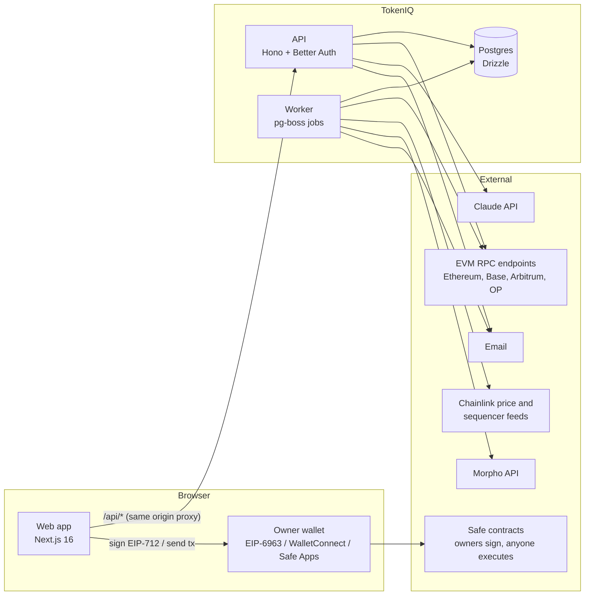
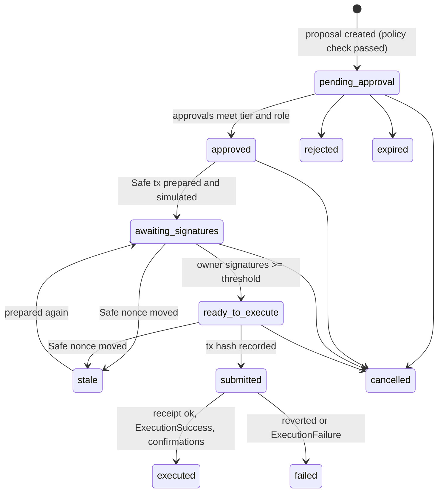

# Architecture

TokenIQ is a pnpm monorepo with three runtime services and four shared packages.

## Repository layout

| Path | What it is |
|---|---|
| `packages/core` | The deterministic treasury engine: exact money maths, obligations and recurrence, valuation, reserve rules, deployable surplus, venue suitability, action validation, recommendations, approval tiers, risk rules and scenarios. Pure TypeScript with no I/O. It runs in the API, the worker, the copilot tools and the browser (landing demo). |
| `packages/chain` | On-chain access: chain registry, token allowlist with Chainlink feeds, readers at pinned blocks, Safe detection, EIP-712 hashing, signer recovery, MultiSend, simulation, ERC-4626 and Aave builders, Morpho and Aave adapters, the vetted venue listing, payment verification and execution tracking. |
| `packages/db` | Drizzle schema, SQL migrations and the database client. Numeric columns are returned as strings so money never passes through a float. |
| `packages/contracts` | Foundry project with `TreasuryReserveGuard`, a Safe v1.5 module guard that bounds automation. Includes tests, a deploy script and the self-review. |
| `apps/api` | HTTP API (Hono, OpenAPI 3.1). Hosts Better Auth for identity, organization-scoped modules, the copilot and (optionally) the jobs. `src/worker.ts` runs the jobs on their own. |
| `apps/web` | Next.js 16 app: marketing site, sign-in, onboarding and the authenticated app (`/app/*`). Talks to the API through a same-origin `/api` rewrite. |
| `apps/e2e` | Playwright end-to-end and accessibility tests. |

## Request path and boundaries

1. **Edge.** The browser only ever calls its own origin. Next rewrites `/api/*` to the API service, so session cookies are first-party, `SameSite=Lax` and `httpOnly`.
2. **API middleware**, in order: request id → security headers → origin check on every state-changing request (CSRF defence in depth) → body limit → rate limit → session (Better Auth) → organization membership for `/api/v1/orgs/:orgId/*` (non-members get 404).
3. **Authorization.** Each handler asserts a permission from `lib/authz.ts`. The browser hides controls via a mirror of the same matrix, but the API is the boundary.
4. **Engine.** Handlers load an `OrgState` (`services/state.ts`): accounts, the latest snapshots, prices, obligations, payments, pending proposals, venue data and policies. The deterministic engine then computes everything shown or validated. The same function feeds the overview, recommendations, proposals, risk alerts and copilot tools, so they always agree.
5. **Writes** happen inside transactions together with an `audit_events` row. Audit events, approval decisions, Safe signatures and policy versions are append-only, enforced by database triggers.

## The financial model

- **Reserve-eligible capital.** Liquid stablecoins in accounts whose control is verified. They are valued at the oracle price, never above $1 for USD stablecoins, less any policy haircut. Positions in protocols do not count toward the reserve.
- **Requirement.** The strictest enabled rule:
  - a fixed floor;
  - runway months × monthly burn, where burn is the larger of the declared figure and the itemized recurring obligations;
  - unpaid obligations due within the horizon, plus overdue ones, plus a buffer.
- **Deployable.** The smaller of:
  - reserve-eligible − requirement − pending outflows;
  - room under the maximum-deployed share of the treasury.
- **Proposals.** A structured action is re-validated against current data three times: at creation, when the Safe transaction is prepared, and immediately before submission. Venue addresses come from the code-defined listing, never from API data.

The detailed rules and worked examples are in `/docs/how-calculations-work` on the public site and in `packages/core/test`.

## Execution: three independent tracks

TokenIQ never holds keys:
- Owners sign the EIP-712 Safe transaction hash in their own wallets.
- The API recovers each signer and checks it against the owners it reads live from the chain.
- Any wallet can submit `execTransaction` with the collected signatures.

The Safe Transaction Service is not required. Using it would add a dependency on its API key and rate limits.

## Background jobs (pg-boss)

| Queue | Schedule | Purpose |
|---|---|---|
| `sync-all-accounts` → `sync-account` | every 5 min | Balances and listed-venue positions at one pinned block; Safe owners, threshold, nonce, modules and guard. Revokes verification if the verifying owner was removed |
| `refresh-prices` | every 5 min | Chainlink observations (idempotent per round); L2 sequencer status |
| `refresh-opportunities` | every 15 min | Morpho API and on-chain Aave venue data. Listing is decided by code |
| `track-all-executions` → `track-execution` | every minute | Receipts, Safe events and confirmations for submitted proposals. Reconciles balances and settles payment proposals |
| `evaluate-all` → `evaluate-org` | every 10 min and after data changes | Risk alerts (de-duplicated by fingerprint) and recommendations; notifications |

Jobs are idempotent:
- snapshots are unique per account, asset and block;
- price observations are unique per round;
- alerts are unique per active fingerprint;
- proposal states only move forward.

Provider health is recorded from TokenIQ's own calls and drives alerts and the status page.

## Copilot

`modules/copilot.ts` runs a streaming tool loop with Claude:
- **Model:** `claude-opus-5-5` by default; `COPILOT_MODEL` overrides it. A server-side refusal fallback is enabled.
- **Tools:** the tools in `services/copilot-tools.ts` are read-only or hypothetical. They are bound to the organization from the session and return records with `ref` ids that answers must cite.
- **Untrusted data:** text written by members or external sources is wrapped as untrusted data.
- **History:** stored append-only and replayed unchanged.
- **Limits and availability:** 40 messages per user per hour. Without `ANTHROPIC_API_KEY` the copilot reports "not configured" and the rest of the product is unaffected.

## Key decisions

See [`docs/adr`](adr) for the architecture decision records.
