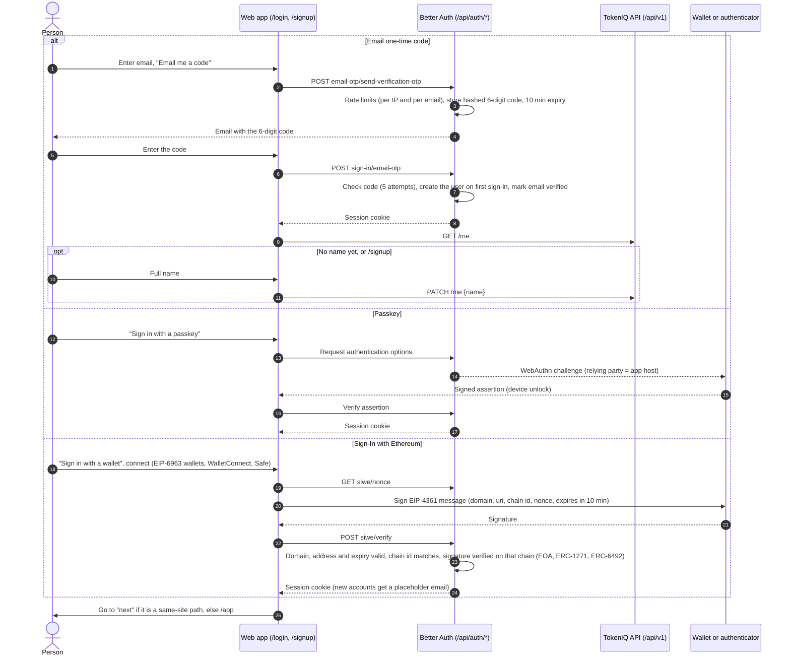
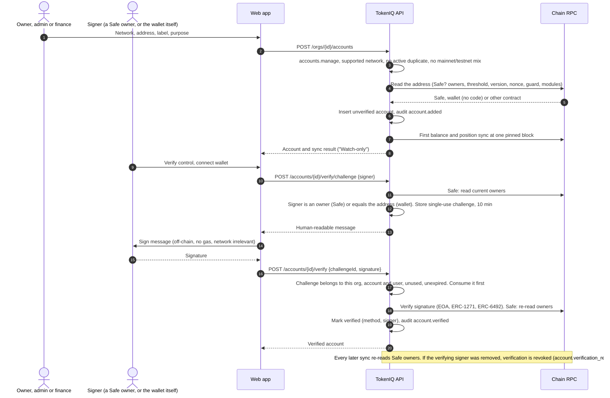
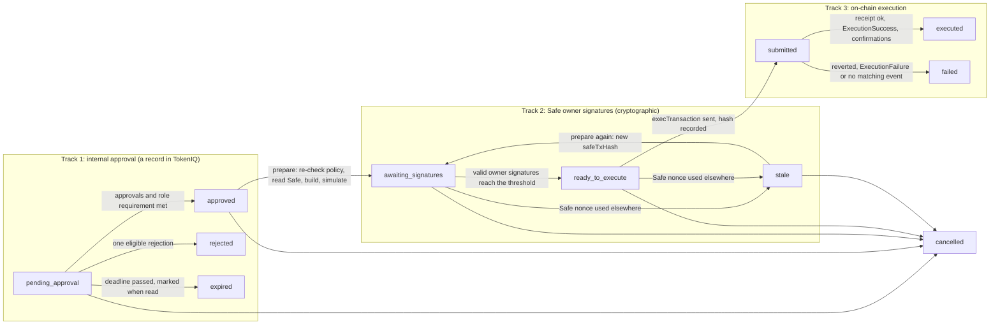
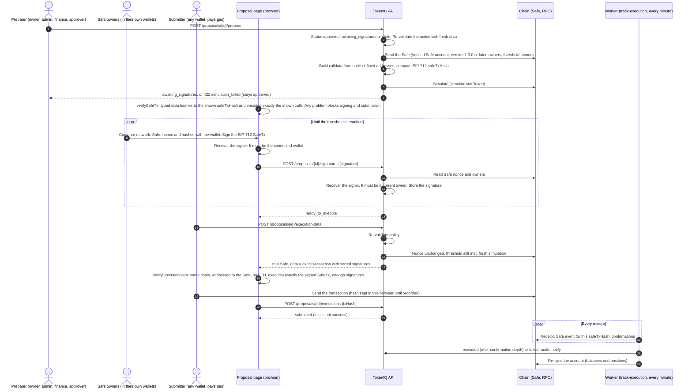

# TokenIQ user flows

This document describes every route in the web app and the main flows through it. For each flow it covers what the person does, what the API checks at each step, what can go wrong, and what is written to the audit log.

It is written from the code:

- `apps/web/src/app/**`, `apps/web/src/components/**`, `apps/web/src/lib/{api,org}.ts`;
- `apps/api/src/{app,auth}.ts`, `apps/api/src/modules/*.ts`, `apps/api/src/services/*`, `apps/api/src/jobs/*`;
- `packages/core/src/*` (the deterministic engine).

Where the code behaves differently from what you might expect, this document describes what the code does. The difference is listed under [Gaps noticed](#gaps-noticed) at the end.

Related documents: `docs/API.md` (endpoints and error codes), `docs/ARCHITECTURE.md`, `docs/DATA_MODEL.md`, `docs/DESIGN_SYSTEM.md`.

---

## Contents

- [How access works](#how-access-works)
- [Route map](#route-map)
- [Flow 1: Sign up, sign in and sign out](#flow-1-sign-up-sign-in-and-sign-out)
- [Flow 2: Create an organization or open the sample workspace](#flow-2-create-an-organization-or-open-the-sample-workspace)
- [Flow 3: Onboarding](#flow-3-onboarding)
- [Flow 4: Add a Safe or wallet and verify control](#flow-4-add-a-safe-or-wallet-and-verify-control)
- [Flow 5: Obligations and payments](#flow-5-obligations-and-payments)
- [Flow 6: Reserves, deployable surplus and scenarios](#flow-6-reserves-deployable-surplus-and-scenarios)
- [Flow 7: Opportunity → recommendation → proposal](#flow-7-opportunity--recommendation--proposal)
- [Flow 8: Internal approval](#flow-8-internal-approval)
- [Flow 9: Safe transaction, signatures, execution and reconciliation](#flow-9-safe-transaction-signatures-execution-and-reconciliation)
- [Flow 10: Risk alerts and notifications](#flow-10-risk-alerts-and-notifications)
- [Flow 11: Copilot conversation](#flow-11-copilot-conversation)
- [Flow 12: Reports, exports and the activity log](#flow-12-reports-exports-and-the-activity-log)
- [Flow 13: Team management](#flow-13-team-management)
- [Flow 14: Policy change](#flow-14-policy-change)
- [Audit log catalogue](#audit-log-catalogue)
- [Gaps noticed](#gaps-noticed)

---

## How access works

**Identity.** Better Auth under `/api/auth/*` handles sign-in by email one-time code, passkey, or Sign-In with Ethereum (SIWE). The session is an `httpOnly`, `SameSite=Lax` cookie with the `tokeniq` prefix. Sessions last 7 days and are refreshed every 12 hours. A 60-second cookie cache means a revoked session stops working within a minute.

**Organization scope.** Every route under `/api/v1/orgs/{orgId}/…` requires membership in that organization.

- A non-member receives `404 not_found`, so organization ids do not leak.
- Every web query key starts with the active organization id. Switching organizations clears the cache, so data from two organizations is never mixed.

**Roles and permissions.** The server enforces permissions in `apps/api/src/lib/authz.ts`. The web app mirrors them with `useCan()` in `lib/org.tsx` to hide controls; it does not enforce anything.

| Permission | owner | admin | finance | approver | viewer |
|---|---|---|---|---|---|
| Read everything in the organization (`org.read`), export reports, use the copilot | ✓ | ✓ | ✓ | ✓ | ✓ |
| Manage organization details, members and invitations (`org.manage`, `members.manage`) | ✓ | ✓ | | | |
| Change treasury and approval policies (`policy.write`) | ✓ | ✓ | | | |
| Add, edit and stop tracking accounts; record obligations and payments; dismiss recommendations; create proposals | ✓ | ✓ | ✓ | | |
| Verify account control; approve or reject; prepare and sign Safe transactions; submit execution; acknowledge alerts | ✓ | ✓ | ✓ | ✓ | |

Rules about roles:

- Only owners can grant, change or remove the owner role.
- An organization always keeps at least one owner.

**Request hygiene.** These apply to every request (`apps/api/src/app.ts`):

- Writes (`POST`, `PUT`, `PATCH`, `DELETE`) must come from the app's origin. Otherwise the API returns `403 bad_origin`.
- Request bodies are limited to 6 MB.
- `/api/v1/*` allows 300 requests per minute, counted per user once signed in and per IP before.
- Validation failures return `400 validation_error` with field paths. The web app maps these onto form fields.

**Kill switches.** `DISABLED_FEATURES` can turn off `copilot`, `proposals`, `signatures`, `sync`, `opportunities` or `email`. Affected routes return `503` with a specific code.

**Audit.** Most state changes write an `audit_events` row with:

- the actor (user, system or copilot);
- the action, target and data;
- the IP address and user agent.

`audit_events`, `approvals` and `policy_versions` are append-only (enforced by a database trigger). The full list of actions is in [Audit log catalogue](#audit-log-catalogue).

---

## Route map

"Signed-in" means any authenticated person. "Member" means a member of the active organization, in any role, unless a role is stated. Pages under `/app` and `/onboarding` are `noindex`.

### Public marketing (`app/(marketing)`)

All public. Marketing pages share the site header and footer.

| Route | Purpose |
|---|---|
| `/` | Landing page. Includes an interactive treasury model that runs the real engine on illustrative inputs. |
| `/product` | Product overview. |
| `/how-it-works` | Step-by-step: what you do, what TokenIQ does, what it never does. |
| `/security` | Custody model, security posture, disclosure guidelines. |
| `/integrations` | Supported networks, assets, venues and data sources. |
| `/pricing` | Pricing. |
| `/docs` | Documentation index. |
| `/docs/[slug]` | One documentation page. Valid slugs: `getting-started`, `reserve`, `obligations`, `deployable-surplus`, `policies`, `approvals-signatures-execution`, `calculation-reference`, `faq`. Any other slug returns 404. |
| `/status` | Live component and data-provider status from `GET /api/status`. A component that was never checked is shown as unknown. |
| `/contact` | Contact channels (`mailto:` links). No form. |
| `/legal/privacy`, `/legal/terms`, `/legal/risks` | Privacy notice, terms of use and risk disclosure. All marked as drafts pending legal review. |

### Authentication (`app/(auth)`)

| Route | Purpose | Access |
|---|---|---|
| `/login` | Sign in by email code, passkey or wallet. Query parameters: `next` (same-site path to return to), `reason` (`session`, `signed_out`, `invite`), `email` (prefill). | Public. A signed-in person is not redirected away. |
| `/signup` | The same flow with sign-up wording. It always asks for a name after an email code. | Public. |

### Invitation

| Route | Purpose | Access |
|---|---|---|
| `/invite/[id]` | View, accept or decline an invitation. | Signed-in, and the account's email must match the invitation. Signed-out visitors are sent to `/login?next=/invite/{id}&reason=invite`. Anyone else sees "This invitation is for a different email address". |

### Onboarding (`app/onboarding`)

| Route | Purpose | Access |
|---|---|---|
| `/onboarding` | Redirects to `/onboarding/organization`. | Signed-in. |
| `/onboarding/organization` | Step 1 of 4: create an organization, or open a sample workspace. | Signed-in (submitting requires a session). |
| `/onboarding/treasury` | Step 2: add and verify a treasury account. `?sample=1` shows a prompt to open the sample workspace. | Signed-in member of a non-sample organization. Adding accounts needs owner, admin or finance. |
| `/onboarding/obligations` | Step 3: monthly spend estimate and main commitments. | As above. The spend estimate needs owner or admin. Obligations need owner, admin or finance. |
| `/onboarding/policy` | Step 4: choose a starting policy and finish. | As above. Changing the policy needs owner or admin. |
| `/onboarding/complete` | Summary of what TokenIQ computed, and next steps. | As above. |

Steps 2–4 act on the remembered organization if it is a real (non-sample) one. Otherwise they act on the most recently created non-sample organization. "Save and exit" in the header links to `/app`.

### App (`app/app`, inside `AppShell`)

All app routes need a session and at least one membership. Someone with no organization is sent to `/onboarding`, and a 401 sends the browser to `/login?next=…&reason=session`. Every member can open every page; controls a role cannot use are hidden, and the API refuses them anyway.

| Route | Purpose | Actions and who can take them |
|---|---|---|
| `/app` | Overview: "Safe to deploy now", allocation bar, the calculation ledger, KPIs, projected liquidity, upcoming obligations, approvals. | Links only. |
| `/app/approvals` | Proposals in progress or closed (`Segmented`). | — |
| `/app/approvals/[id]` | One proposal: policy check, internal approval, Safe signatures, execution, discussion. | Approve or reject (owner, admin, finance, approver; not the proposer by default). Prepare and sign (same four roles). Submit execution (same four roles). Cancel (proposer, owner, admin). Comment (any member). |
| `/app/copilot` | Chat with the read-only treasury copilot. | Any member. |
| `/app/obligations` | Obligations list and schedule. `?new=1` opens the form. | Create and edit: owner, admin, finance. |
| `/app/obligations/[id]` | One obligation: details, upcoming dates, payment history, documents, notes. | Edit, pause, cancel, record payment, upload documents: owner, admin, finance. |
| `/app/payments` | Unpaid and overdue occurrences, and recorded payments. `?record=` opens the record sheet. | Record, re-verify, undo: owner, admin, finance. |
| `/app/reserves` | Requirement and its rules, coverage, burn, policy editor and history, stress scenarios (`#scenarios`). | Edit policy: owner, admin. Run scenarios: any member. |
| `/app/treasury` | Balances by asset, network and account. Price sources, history chart, sync status and data issues (`#issues`). | — |
| `/app/accounts` | Safes and wallets. `?add=1`, `?verify=<id>`, `?safe=<id>`, `?edit=<id>` open sheets. | Add, edit, stop tracking: owner, admin, finance. Verify: plus approver. Sync now: any member. |
| `/app/allocations` | Current positions in protocols, withdrawability, net APY. | — |
| `/app/recommendations` | Engine recommendations (`?show=all`, `#<id>`). | Create proposal and dismiss: owner, admin, finance. |
| `/app/opportunities` | Venues with suitability against policy (`?venue=<id>` opens the detail sheet). | Read-only. |
| `/app/risk` | Active and resolved alerts. | Acknowledge: owner, admin, finance, approver. |
| `/app/activity` | Audit trail (`?action=<prefix>` filter). | — |
| `/app/reports` | Printable snapshot link and CSV exports. | Any member (viewers included). |
| `/app/reports/snapshot` | Printable one-page snapshot. | Any member. |
| `/app/team` | Members, pending invitations, role reference. | Invite, change role, remove, revoke: owner, admin. Leave: anyone (except the last owner). |
| `/app/settings` | Tabs (`?tab=`): `organization`, `approvals`, `security`, `preferences`. | Organization and approval policy: owner, admin. Security (passkeys, sessions, wallets) and preferences: personal, anyone. |
| `/app/help` | Setup progress, how calculations work, approvals versus signatures versus execution, autonomy levels. | — |

### System pages and files

| Route | Purpose | Access |
|---|---|---|
| (any unknown path) | `not-found.tsx`: "This page isn't on the ledger." | Public. |
| (route error) | `error.tsx`: "This page couldn't load." Shows a reference digest and the UTC time, with retry. | — |
| (root failure) | `global-error.tsx`: "TokenIQ couldn't start." | — |
| `/forbidden` | Static "You don't have access to this." page, with a summary of role limits. | Public. No code path currently links to it. |
| `/offline` | Served by the service worker when a navigation fails. Fully static, and states that cached figures are never shown. | Public. Precached. |
| `/manifest.webmanifest` | PWA manifest (`manifest.ts`). Start URL `/app`. Shortcuts to Overview and Approvals. CORS allows `https://app.safe.global`. | Public. |
| `/sw.js` | Service worker. Navigations are network-first and never cached. `/api/*` is never intercepted. Build assets are cache-first. | Public. |
| `/robots.txt`, `/sitemap.xml` | Robots rules (disallow `/app`, `/api`, `/onboarding`, `/login`, `/signup`, `/offline`, `/forbidden`) and a sitemap of public pages and docs. | Public. |

TokenIQ can also run inside Safe{Wallet} as a Safe App: the content security policy allows framing by `https://app.safe.global`, and wagmi includes the `safe` connector.

---

## Flow 1: Sign up, sign in and sign out

**Entry points**

- "Sign in" and "Get started" on the public site.
- A redirect after a 401 (`/login?next=…&reason=session`).
- An invitation link (`reason=invite`).
- Signing out (`reason=signed_out`).

Sign-up and sign-in are the same flow. The first successful email-code sign-in creates the account. `/signup` changes only the wording, and always asks for a name.

### Steps and server checks

| # | Step | Server checks and effects |
|---|---|---|
| 1 | **Email code: request.** Person enters an email and chooses "Email me a code". The client checks the email format. | Better Auth allows 5 requests per minute per IP. The API wrapper also allows 5 per 15 minutes per email address. Better Auth has a global limit of 60 per minute. A 6-digit code is generated, stored hashed, valid for 10 minutes, and emailed. Without SMTP in development, the code is written to the API log. In production a missing `SMTP_URL` is an error. |
| 2 | **Email code: verify.** Person enters the code. Resend is available after a 30-second cooldown. | 10 attempts per minute per IP and 10 per 15 minutes per email. Each code allows 5 attempts. On success the user is created if new, the email is marked verified, and a session cookie is set. |
| 3 | **Name.** Shown if the user has no name, if the name equals the email's local part, or in sign-up mode. | `PATCH /api/v1/me` with a name of 1–80 characters. |
| 4 | **Passkey.** "Sign in with a passkey". | The passkey's relying party is the app's hostname and its origin is `APP_URL`. A passkey must have been added earlier in Settings → Security, which requires being signed in. |
| 5 | **Wallet (SIWE).** Connect a wallet, then "Sign message to continue". | The nonce endpoint allows 20 per minute and verify allows 10 per minute. The server checks the message's domain, address and validity window, that its chain id equals the one claimed, and that an RPC client exists for that chain. It then verifies the signature on-chain, which supports smart-contract wallets. New wallet accounts get a placeholder email on `wallet.tokeniq.invalid` (`hasRealEmail: false`). Signing in with a wallet does not make it a treasury account (see Flow 4). |
| 6 | **Redirect.** | `next` must start with `/` and contain no control characters or backslashes. It is then resolved against the app's origin and must stay on it. Otherwise the person goes to `/app`. In `/app`, someone with no organization is sent to `/onboarding`. |
| 7 | **Sign out.** Account menu → "Sign out". | Better Auth sign-out revokes the session and clears the cookie. The client clears its query cache and goes to `/login?reason=signed_out` ("You signed out."). |
| 8 | **Revoke other sessions.** Settings → Security. | Lists sessions, revokes one, or "sign out every other session". Passkeys can be added (named) and removed there. |

### Failure and edge cases

**Email code**

- An invalid email is caught on the client: "Enter a valid email address."
- Too many codes: "Too many codes requested. Wait a minute and try again." The API wrapper's per-email limit returns `429` with `retry-after`.
- A wrong or expired code: "That code is incorrect or has expired." The field is cleared. After 5 attempts: "Too many incorrect attempts. Request a new code."
- If saving the name fails, the error is swallowed and the person continues without a name (see Gaps).

**Passkey and wallet**

- A cancelled passkey prompt: "Passkey sign-in was cancelled." No matching passkey: "No passkey worked for this site. Use email instead, then add a passkey in Settings."
- A rejected wallet signature: "You declined the signature request. Nothing was signed." An expired or invalid message: "Sign-in failed. The message may have expired; try again."
- Wallet-only accounts cannot accept email invitations (see Flow 13 and Gaps) and receive no email alerts.

**Sessions**

- An expired session on any page sends the browser to `/login` with "Your session expired. Sign in again to continue where you left off." The same message appears for someone who was never signed in (see Gaps).

### Audit log

Nothing is written to `audit_events`. Sign-in, sign-out, session revocation and passkey changes are recorded only in Better Auth's own tables (sessions with IP and user agent, passkeys, verifications). Changing the display name is not audited.

---

## Flow 2: Create an organization or open the sample workspace

**Entry points**

- `/onboarding/organization` (where a signed-in person with no organization lands).
- Organization switcher → "New organization".
- Onboarding step 2 → "Use a sample workspace instead", or `/onboarding/treasury?sample=1`.

### Create an organization

| # | Step | Server checks and effects |
|---|---|---|
| 1 | Enter the organization name (2–80 characters) and optionally what the treasury funds (up to 280). "Create organization". | `POST /api/v1/orgs`. Any signed-in user can create an organization. A `preset` field is accepted (`conservative`, `balanced`, `growth`); the onboarding form does not send it, so the default `balanced` applies. |
| 2 | — | In one transaction, the API: creates the organization with a slug plus a random suffix; makes the creator `owner`; creates the profile with `onboardingSteps = ["organization"]`; writes treasury policy v1 and approval policy v1 (reason "Initial policy"); and writes the audit event. |
| 3 | The web app remembers the new organization as active and goes to `/onboarding/treasury`. | — |

### Open the sample workspace

| # | Step | Server checks and effects |
|---|---|---|
| 1 | "Open a sample workspace" (step 1) or "Use a sample workspace instead" (step 2). | `POST /api/v1/sample-workspace`. Any signed-in user. Step 2 reuses an existing sample workspace if the person has one. Step 1 always creates a new one. |
| 2 | — | Creates an organization named "Sample: Northwind Protocol" with `isSample = true`, using the same code path (so `organization.created` is audited with `isSample: true`, and the creator is its owner). It then inserts: |
| | | • Two Safe accounts with synthetic addresses that belong to no one: "Operations Safe (sample)" (`0x5a3e…0001`, Base, threshold 2) and "Reserve Safe (sample)" (`0x5a3e…0002`, Ethereum, threshold 3). They have no owner list and `verificationMethod = "sample"`. |
| | | • Simulated USDC, EURC and USDT balance snapshots every 3 days over the last 30 days. |
| | | • Six obligations: payroll $68,000 monthly; an audit invoice of $45,000; infrastructure $6,400 monthly; a €9,500 legal retainer monthly; a $30,000 conference estimate; a $120,000 grants estimate. |
| 3 | The web app switches to the sample organization and opens `/app`. | — |

### How sample data is labelled and isolated

**Isolation**

- It is a separate organization row. Every query is organization-scoped, so sample data never mixes with real data.
- Onboarding steps 2–4 skip sample organizations.

**Simulated values** (`services/state.ts`)

- Stablecoins are valued at a simulated $1.00 ("Sample workspace (simulated $1.00)"). Other assets have no price.
- EUR converts at a simulated 1.08 if no live EUR/USD rate exists.
- "Last observed" is always now.

**Never synced or verified**

- Background sync skips accounts with `verificationMethod = "sample"`.
- Manual sync returns `409 sample_workspace`, and so does a verification challenge.

**Nothing can execute.** Proposals can be created and approved, to show the flow. Preparing, signing and getting execution data all return `409 sample_workspace`: "This is a sample workspace with simulated accounts. Nothing here can be signed or executed."

**Alerts.** Risk alerts are computed but no alert notifications or emails are sent for sample organizations. Proposal notifications are still sent.

**Labels.** See `docs/DESIGN_SYSTEM.md` §9.4:

- the shell banner;
- "Sample workspace" in the organization switcher;
- "(sample)" account labels and the "Sample" badge;
- the price source;
- callouts on recommendations and proposals.

### Failure and edge cases

- A name shorter than 2 characters keeps the button disabled. Server field errors map onto the form.
- Repeated "Open a sample workspace" clicks from step 1 create additional sample organizations (see Gaps).
- A sample organization cannot be deleted, and its only owner cannot leave it because of the last-owner rule (see Gaps).

### Audit log

`organization.created` (with `name` and `isSample`). The individual sample records are not audited.

---

## Flow 3: Onboarding

The flow is treasury accounts → obligations → policy preset → complete. Each step saves progress, so people can leave ("Save and exit") and return. Completed steps become links in the progress bar.

**Entry points:** automatically after creating an organization. Otherwise `/onboarding/treasury` directly, or the Help page's "Getting started".

| # | Step | What the person does | Server checks and effects |
|---|---|---|---|
| 1 | Organization | Covered in Flow 2. "Back" from step 2 opens a dialog that edits the existing organization instead of creating another. | `PATCH /orgs/{id}` needs owner or admin, and writes `organization.updated`. |
| 2 | **Treasury** (`/onboarding/treasury`) | Paste a Safe or wallet address, then optionally verify control. "Continue" is disabled until at least one account exists. "Skip for now" moves on without saving progress. | Adding and verifying follow Flow 4. "Continue" calls `POST /orgs/{id}/onboarding {step: "treasury"}`. |
| 3 | **Obligations** (`/onboarding/obligations`) | Optional monthly operating spend, plus up to 5 commitments: title, amount, USD or EUR, first due date, monthly or once, certainty, category. The category is guessed from the title until the person picks one. "Save and continue" or "Skip for now". | The spend estimate is saved only for owners and admins, with `PUT /policies/treasury` (reason "Onboarding: monthly burn estimate", with `expectedVersion`). This creates a new policy version. Each row is `POST /obligations`, with priority `critical` for payroll and taxes and `normal` otherwise. Then `POST /onboarding {step: "obligations"}`. |
| 4 | **Policy** (`/onboarding/policy`) | Choose Conservative, Balanced or Growth (radio cards). Adjust runway (stepper, 0–36 months, 0 means off) and an optional minimum reserve. "Finish setup". | If anything changed and the role allows it, `PUT /policies/treasury` (reason "Onboarding: initial policy", `expectedVersion`). Then `POST /onboarding {step: "policy", complete: true}`, which sets `onboardingCompletedAt`. |
| 5 | **Complete** (`/onboarding/complete`) | Read the summary, then follow next steps (verify accounts, invite the team, review recommendations) or "Go to the overview". | Read-only: `GET /treasury`, `GET /obligations?status=active`, `GET /policies`. |

The presets (from `@tokeniq/core` `POLICY_PRESETS`):

| Preset | Runway | Obligation horizon and buffer | Maximum deployed | Per protocol / per venue |
|---|---|---|---|---|
| Conservative | 12 months | 180 days, +20% | 30% | 15% / 10% |
| Balanced (default) | 6 months | 90 days, +10% | 50% | 25% / 20% |
| Growth | 3 months | 60 days, +10% | 70% | 35% / 25% |

### Failure and edge cases

**Roles below owner or admin**

- The spend estimate and policy controls are disabled, with an explanation ("Only owners and admins can set this").
- Finishing keeps the current policy version.
- If the server refuses the spend estimate with 403, the obligations are still saved and a warning explains that the spend wasn't.

**Validation**

- Per row: title of at least 2 characters, amount above zero, a due date. Errors appear on the row. Rows already saved are locked and marked "Saved", so a retry does not resend them.

**Conflicts**

- If someone saved the policy meanwhile, the step gets `409 policy_version_conflict`. It reloads the policy, keeps the person's choices, and asks them to save again.

**No organization to set up**

- If the person has no non-sample organization: "Create your organization first."

**Partial save**

- If saving fails partway, the message reads "Anything marked saved is stored; save again to finish."

**Policy endpoint**

- `POST /onboarding` has no role check. Any member can record progress or completion (see Gaps).

### Audit log

- `policy.treasury_updated` (when the spend estimate or policy is saved, with the reason and field-level changes);
- `obligation.created` for each commitment;
- `onboarding.completed` (on finish);
- `organization.updated` (if edited through "Back");
- the Flow 4 events for accounts.

Recording a step's progress without completing is not audited.

---

## Flow 4: Add a Safe or wallet and verify control

Adding an account makes it **watch-only**. TokenIQ reads balances and never holds keys. Until a member proves control by signing a challenge, its value is excluded from reserve maths. The policy flag `includeUnverifiedInReserve` is `false` by default.

**Entry points**

- `/app/accounts?add=1`.
- Command palette → "Add a treasury account".
- Onboarding step 2.
- "Verify" on an account row (`/app/accounts?verify=<id>`).

### Steps and server checks

| # | Step | Server checks and effects |
|---|---|---|
| 1 | Choose a network (mainnets and testnets in separate groups) and paste an address. `AddressInput` checks the format and checksum on blur. Add a label (1–60 characters) and a purpose (operating, reserve, grants, other). | `POST /orgs/{id}/accounts`. Checks, in order: role `accounts.manage`; the network is supported (`400 unsupported_chain`); an RPC client exists (`503 chain_unavailable`); the address is not already tracked on that network (`409 duplicate_account`); and the organization does not mix mainnet and testnet accounts (`422 mixed_networks`). |
| 2 | "Add account" (takes a few seconds while it reads on-chain). | The API reads the address to classify it: `safe` (stores owners, threshold, version, nonce, guard and modules), `eoa` (no code) or `contract`. If the read fails: `503 chain_read_failed`, "…Nothing was added; try again shortly." A previously archived account at the same address is restored, with its verification reset. The insert and audit happen in one transaction. A first sync runs inline; sync failures are stored on the account, not returned as errors. A risk and recommendation evaluation is queued. |
| 3 | The result shows "Watch-only … excluded from reserve maths until someone proves control", plus what the first sync found. | — |
| 4 | **Verify.** Open the verify sheet. Step 1: connect a wallet. Step 2: prepare the message. Step 3: sign and submit. The sheet pre-checks whether the connected wallet is an owner (Safe) or the account itself (wallet). "Check on-chain anyway" overrides a stale owner list. | `POST …/verify/challenge {signer}` requires `accounts.verify` (owner, admin, finance, approver). Sample accounts get `409 sample_workspace`. For a Safe, owners are read live and the signer must be one (`422 not_an_owner`). For a wallet or contract, the signer must be the address itself (`422 wrong_signer`). The stored challenge is bound to organization, account, signer and user, has a random nonce, and expires in 10 minutes. Its text names the organization and states that it authorizes nothing and costs no gas. |
| 5 | Sign in the wallet (personal message). Switching wallets discards the challenge. | `POST …/verify {challengeId, signature}`. The challenge must match the organization, account and current user, be unused and unexpired (`409 challenge_invalid`). It is consumed before the signature is checked, so a signature can never be replayed even if verification fails. The signature is verified through the chain client (`422 bad_signature`). For a Safe, owners are re-read (`422 not_an_owner`). The account is marked verified with method `siwe_owner` (Safe) or `siwe_address` (wallet), plus the signer, user and time. |
| 6 | "<Label> is verified". Its balances now count toward the reserve and deployable figures. | An evaluation is queued. |

Other account actions:

- **Edit** label or purpose, or include/exclude the account from treasury maths: `PATCH`, needs `accounts.manage`, audited with from/to values.
- **Stop tracking**: archive with history kept. Confirmed by typing the account label. `DELETE`, needs `accounts.manage`.
- **Sync now**: `POST …/sync`. Kill switch `sync` applies. Any member can call it.

### Failure and edge cases

- A declined signature is not a failure: "Nothing was signed and nothing changed." The challenge stays valid until it expires (countdown shown).
- When the challenge expires or is already used, the sheet resets to "Prepare a new message".
- A Safe on a version below 1.3.0 can be tracked and verified, but no transactions can be prepared for it (see Flow 9).
- If the verifying owner is later removed from the Safe, the next sync revokes verification and the account drops out of reserve maths. Verified wallet (EOA) accounts are never revoked automatically.
- A wallet used for SIWE sign-in is unrelated. It does not become a treasury account.

### Audit log

- `account.added` (chain, address, kind, label);
- `account.verified` (signer, method, chain);
- `account.updated` (changed fields with from/to);
- `account.archived` (label, address);
- `account.verification_revoked` (system actor, with reason).

Challenge requests and syncs are not audited.

---

## Flow 5: Obligations and payments

### 5a. Record an obligation

**Entry points**

- `/app/obligations?new=1` (Overview "Record obligation", command palette "Record an obligation").
- Onboarding step 3.
- "Edit" on an obligation.

| # | Step | Server checks and effects |
|---|---|---|
| 1 | Fill the sheet: title (2–120), direction (outflow, or inflow for planning only, which never reduces the requirement), amount (above zero, up to 18 decimals), currency (USD or EUR), category (11 options), priority, certainty (Estimate, Committed, Invoiced). | `POST /orgs/{id}/obligations` with `obligations.write` (owner, admin, finance). The body is validated by the `ObligationInput` schema. |
| 2 | Choose one-off or recurring: weekly, monthly, quarterly or yearly, every 1–12 periods, ending never, on a date, or after 1–500 payments. | A recurrence end before the first due date returns `400 invalid_recurrence`. The obligation is owed from today (`trackFrom = today`). If the first due date is in the past, it is owed from that date instead. For a recurring obligation, that makes every occurrence since the first due date overdue (see Gaps). |
| 3 | Optional: counterparty, invoice number, notes (up to 2,000), and payment terms (recipient address, network, asset). The terms are needed for on-chain verification and payment proposals. | The recipient address is stored in lowercase. |
| 4 | Save. | The insert and `obligation.created` audit happen in one transaction. |

Editing uses `PATCH`. Its status actions are pause, resume, cancel and reactivate (`active`, `paused`, `cancelled`, `completed`). Obligations are never deleted.

**Currency.** EUR amounts are converted to USD for reserve maths using the Chainlink EUR/USD feed (Ethereum or Base) and shown with `≈`. If no rate is available, the USD value is unknown and the engine reports it as an uncertainty.

**Documents** (on the obligation page):

- Upload needs `obligations.write`. Only PDF, PNG, JPEG, CSV or plain text up to 5 MB is accepted (`400 unsupported_type`, `file_too_large`). A PDF must start with `%PDF-` (`400 invalid_file`).
- The filename is sanitised, the SHA-256 is computed and shown, and the bytes are stored in the database.
- Download is available to any member, as an attachment with `nosniff`, `default-src 'none'` and `no-store`.
- Documents are never parsed, and never shown to the copilot.
- There is no delete.

### 5b. Mark a payment paid, skipped, or verified on-chain

**Entry points**

- "Record payment" on an obligation or one of its due dates.
- `/app/payments`: the "Unpaid & overdue" rows, "Record payment", or `?record=`.

| # | Step | Server checks and effects |
|---|---|---|
| 1 | Pick the occurrence. On Payments: unpaid due dates in the next 120 days, overdue first. On an obligation: up to a year ahead. | `POST /orgs/{id}/payments` with `payments.record` (owner, admin, finance). The obligation must be in the organization (`404`). The due date must be a real occurrence of it (`400 no_such_occurrence`). It must not be recorded already (`409 already_settled`, also enforced by a unique index). |
| 2 | Choose the outcome: **paid** or **skipped**. | Skipped: recorded as `skipped`, and the occurrence no longer counts as owed. |
| 3 | For paid, optionally add the transaction hash, network and asset (defaults to the obligation's asset, else USDC). | **Without a hash**: `paid_unverified` ("Marked paid — not verified"). **With a hash**: a network is required (`400 chain_required`), an RPC must exist (`503`), the obligation must have a recipient (`422 no_recipient`), and the asset must be a supported ERC-20 on that network (`400 unsupported_asset`). The receipt's `Transfer` logs are decoded and must show the asset reaching the recipient. When the token is pegged to the obligation's currency (USD obligations in USD stablecoins, EUR in EUR stablecoins), the transfer must also carry at least the obligation amount. |
| 4 | — | The on-chain result maps to an outcome:  • `not_found`, `reverted` or `mismatch`: `422 transfer_*`. Nothing is recorded.  • `pending` (in the mempool, or matched with too few confirmations): recorded as `paid_unverified` with the pending verification ("Marked paid — N of M confirmations").  • `verified`: `paid_verified` ("Verified on-chain").  Each on-chain transfer can settle only one occurrence (`409 transfer_already_used`). A one-off obligation becomes `completed` unless the occurrence was skipped. An evaluation is queued. |
| 5 | **Re-check** an unverified payment ("Check again"). | `POST /payments/{id}/verify` with `payments.record`. No hash gives `422 no_transaction`. The check runs again: a match upgrades the record to `paid_verified`; any other result stores the new verification details and keeps the status. |
| 6 | **Undo** a marked-paid or skipped record, with a reason of at least 3 characters. | `DELETE /payments/{id}`. A `paid_verified` payment cannot be undone (`409 verified_payment`). The row is deleted. |

Payments executed through a TokenIQ proposal (Flow 9) are recorded automatically as `paid_verified`, with source `safe_execution`, once the execution is confirmed.

### Failure and edge cases

- Undoing a payment on a one-off obligation does not reactivate the obligation (see Gaps).
- The web app sends an `Idempotency-Key` header on obligation and payment writes, but the API ignores it. Payments are still protected by their unique constraints. Obligations are not (see Gaps).
- No UI creates a payment proposal (paying an obligation from a Safe through TokenIQ). The API supports it (see Flow 7 and Gaps).
- Verification checks recipient, token and amount, but not the sender. A transfer from someone else to the same payee verifies the occurrence (BE-26, open).
- Changing an obligation's recipient address is an edit by owners, admins or finance. It is recorded as `obligation.updated` plus `obligation.payee_changed` (from and to), owners and admins get an in-app notification, and the new-payee hold restarts: payment proposals to the address fail the `payee_hold` check until `newPayeeHoldHours` (approval policy, default 48) have passed (BE-17).

### Audit log

**Obligations**

- `obligation.created` (title, amount, currency, certainty);
- `obligation.updated` or `obligation.cancelled` (changed fields with from/to);
- `obligation.document_uploaded` (filename, SHA-256, size).

**Payments**

- `payment.paid_verified`, `payment.paid_unverified` or `payment.skipped` (due date, transaction hash, chain, verification details);
- `payment.paid_verified` again when a re-check succeeds;
- `payment.undone` (due date, previous status, reason).

Payments settled by a proposal are covered by `proposal.executed`.

---

## Flow 6: Reserves, deployable surplus and scenarios

**Entry points**

- Overview (`/app`), Reserves (`/app/reserves`), Balances (`/app/treasury`), Allocations (`/app/allocations`).
- Command palette → "Run a stress scenario" (`/app/reserves#scenarios`).

### Review (read-only)

| # | Step | Server checks and effects |
|---|---|---|
| 1 | Open the Overview: "Safe to deploy now" (exact figure), coverage and input badges, the position sentence, the allocation bar, "How this is calculated", KPIs, projected liquidity and upcoming obligations. | `GET /orgs/{id}/treasury`, any member. The engine (`loadOrgState` → `computeTreasury` → `assessReserve`) runs on stored observations. It writes nothing and is not audited. |
| 2 | — | **Inputs:**  • the latest balance snapshot per account and asset, for allowlisted tokens only;  • positions in listed venues;  • the latest Chainlink prices, marked stale beyond the feed heartbeat;  • the EUR/USD rate;  • unsettled obligation occurrences;  • active allocation proposals (as pending outflows). |
| 3 | — | **Reserve-eligible capital**: liquid stablecoins in verified, included accounts, after policy haircuts, valued at no more than $1.  **Requirement**: the strictest enabled rule among:  • floor: the minimum reserve;  • runway: months × monthly burn, using the larger of the declared estimate and itemised recurring obligations;  • obligations: unsettled outflows due within the horizon plus overdue ones, × (1 + buffer). Estimates count only if the policy includes them. |
| 4 | — | **Coverage**: covered, thin (below `thinCoverageBps`, default 110%), shortfall, or no requirement.  **Deployable** = min(reserve-eligible − requirement − pending outflows, gross × max-deployed − already allocated − pending allocations), floored at zero.  **Uncertainty reasons** are listed when figures may be incomplete. |
| 5 | Reserves page: rule cards with the binding rule, "From requirement to deployable", monthly burn, the policy editor (Flow 14) and policy history. | `GET /policies`, `GET /policies/history`. |
| 6 | Balances page: holdings with price source and age, the history chart, sync status and data issues. | `GET /treasury/history?days=` (last observation per day; absent before the first one, never zero). `GET /treasury/sync-status`. |

### Run a scenario (hypothetical, writes nothing)

| # | Step | Server checks and effects |
|---|---|---|
| 1 | In "Stress scenarios", choose one shock:  • a new obligation (title, USD amount, due date, monthly or not);  • a depeg (stablecoin and price; presets: USDC at $0.97 or $0.90, USDT at $0.95);  • a burn change;  • runway months (0–36);  • a frozen venue (if positions exist). | `POST /orgs/{id}/treasury/scenario {shocks: [1–8]}`. Any member; there is no permission check beyond membership. A depeg price above 2 returns `400 invalid_price`. |
| 2 | Run it. | The engine evaluates the current state and a shocked copy side by side. Nothing is stored and nothing is audited. The response is labelled "Scenario — hypothetical, no data was changed". |
| 3 | Compare base, scenario and change: requirement, binding rule, reserve-eligible, deployable, coverage status, shortfall and runway covered. Worse outcomes are marked. | — |

The UI sends one shock per run. The API and the copilot's `run_scenario` tool accept up to 8 combined shocks.

### Failure and edge cases

- Missing prices, stale prices, unsynced accounts and unverified balances appear as data issues. The Overview then says "Some figures are incomplete … Recommendations are paused until data is complete."
- Without a monthly burn estimate, runway shows `—` with "Add a monthly burn estimate".
- Pending allocation proposals are subtracted from deployable as soon as they are created, and count toward per-venue and per-protocol limits, until they leave the active statuses. A proposal still awaiting approval stops counting the moment its deadline passes, whether or not it has been marked expired yet. A proposal is never counted against itself when it is re-checked.

### Audit log

None. Reads and scenarios are not audited.

---

## Flow 7: Opportunity → recommendation → proposal

**Entry points**

- `/app/opportunities` (venues).
- `/app/recommendations`.
- Overview → "Review recommendations".
- Notifications and links to `/app/recommendations#<id>`.

| # | Stage | What the person does | Server checks and effects |
|---|---|---|---|
| 1 | **Venue data** (worker) | — | Every 15 minutes the worker fetches Morpho USDC vaults on Base and Ethereum (TVL at least $10M) and Aave v3 on four mainnets. Whether a venue can be executed against is decided in code (`isListed`), never by the data source. Each venue is stored with a snapshot and provider health is recorded. Kill switch: `opportunities`. |
| 2 | **Opportunities** (read-only) | Browse venues with net APY (as measured, "not a promise"), TVL, liquidity, fee, curator, warnings and policy checks. "Listed for execution" is distinguished from "reference only". Filter by network or protocol. Open one (`?venue=`) for full detail. | `GET /orgs/{id}/opportunities`, any member. Suitability against the current policy, a maximum position by liquidity, and illustrative yield on $100k. There is no "propose" action on a venue. |
| 3 | **Recommendations** (engine) | Read a recommendation document: trigger, objective, evidence, policy checks, upside, downside, what could go wrong, liquidity impact, alternatives and basis. | `GET /orgs/{id}/recommendations` runs `generateRecommendations` on current data on every request, and also in the 10-minute evaluation job. Kinds: `deploy_surplus` (allocate from a verified Safe holding an allowed stablecoin into a listed, suitable venue), `restore_reserve` (withdraw from a position), `reduce_concentration`, `hold`. Each has a deterministic fingerprint. New ones are stored as `open`; ones no longer produced become `superseded` ("Conditions changed; no longer applies"). When none apply, `whyNone` explains why (no accounts, incomplete data, observe-only, nothing deployable, no verified Safe, no venue passes). |
| 4 | **Dismiss** (optional) | "Dismiss" with a reason (3–500 characters). | `POST …/recommendations/{id}/dismiss`, `recommendations.manage` (owner, admin, finance). It must be open (otherwise `404`). The same fingerprint stays dismissed. A materially different situation produces a new recommendation. |
| 5 | **Create proposal** | "Create proposal". Only enabled when the recommendation has an action and every policy check passes. Only owners, admins and finance members see it. In a sample workspace a note says nothing can be signed or executed. | `POST /orgs/{id}/proposals {recommendationId, idempotencyKey}`, `proposals.create`. Kill switch: `proposals` (`503`). A key already used returns the existing proposal (`200, duplicate: true`). The recommendation must exist (`404`), be open (`409 recommendation_not_open`) and carry an action (`422 no_action`). |
| 6 | — | — | The action is re-validated with fresh data (`validateAction`). The checks include:  • the account is known, included, verified and a Safe;  • data is complete and fresh;  • the balance is sufficient;  • the USD amount matches the token amount within 1% (at least $1);  • the venue's suitability checks;  • minimum action size;  • within deployable;  • the reserve is still covered afterwards;  • caps on deployed, per-protocol and per-venue;  • share of venue liquidity;  • autonomy is not observe-only.  Any failure returns `422 policy_check_failed` with the checks. |
| 7 | — | — | The proposal is stored as `pending_approval` with: a title ("Deploy $X into <venue>"); the amount; the account and chain; the validation snapshot; the proposer; and `expiresAt` = now + `proposalTtlHours` (default 72). The recommendation becomes `accepted`. An optional note becomes the first comment. The audit event is written in the same transaction. Owners, admins, finance and approvers (except the proposer) get an in-app notification "Review: <title>". |
| 8 | Redirect | The web app opens `/app/approvals/{id}`. A toast says "It now needs internal approvals, then Safe signatures. Nothing has moved yet." | — |

The API also accepts a structured `action` (`allocate`, `withdraw` or `payment`) instead of a recommendation id. Payment actions must:

- target an unpaid occurrence;
- go to the obligation's recorded payee, on its network, in its asset;
- stay within 1% above the amount owed (a warning otherwise).

No screen sends a structured action (see Gaps).

### Failure and edge cases

- If the recommendation was resolved meanwhile: "This recommendation is no longer open … The list has been refreshed."
- If data changed: `422 policy_check_failed`. The toast shows the reason.
- Viewing recommendations changes stored state (new ones inserted, old ones superseded). These changes are not audited.

### Audit log

- `recommendation.dismissed` (reason, title);
- `proposal.created` (title, amount, kind, recommendation id, policy version).

---

## Flow 8: Internal approval

Internal approval is a decision record inside TokenIQ. It is **not** a Safe signature and moves nothing.

**Entry points**

- The Approvals navigation item, with a badge counting proposals that need you.
- The notification "Review: …".
- `/app/approvals/{id}`.

### Rules (from `@tokeniq/core` `approvals.ts`)

**Tier.** The first tier whose upper bound covers the amount, in ascending order. Each policy must end with an unbounded tier. The default policy:

| Amount (USD) | Approvals needed | Role requirement |
|---|---|---|
| Up to $25,000 | 1 | — |
| Up to $250,000 | 2 | — |
| Above $250,000 | 3 | At least one from an owner |

**Who counts**

- Owners, admins, finance and approvers can approve. Viewers never can.
- An owner satisfies any role requirement. An admin satisfies admin, finance and approver requirements.
- Only the latest decision per member counts, and each member can decide once.

**Separation of duties.** The proposer cannot approve or reject their own proposal (`403 cannot_approve`), and their decision would not count. The approval policy can allow this with `allowSelfApproval` (default off).

**Outcome**

- Approved when the required number is reached **and** the role requirement is met.
- **One rejection by an eligible member rejects the proposal.** A rejection needs a comment.

**Policy changes mid-flight.** Each proposal stores the approval policy in force when it was created. Approval is evaluated under both that policy and the current one, and the stricter result wins: loosening the policy never speeds up a proposal in flight, while tightening it applies immediately (BE-16). Self-approval is allowed only if both policies allow it.

**Current members only.** A decision counts only while its author is still a member whose current role may approve, and a role requirement is met only if the approver held the role both when deciding and now. Internal approval is re-checked before the Safe transaction is prepared and before execution data is released. If it no longer holds, the proposal returns to `pending_approval` (or `expired`), the request fails with `409 approval_lapsed`, and a `proposal.approval_lapsed` system event is written.

**Expiry.** A proposal that is not fully approved by `expiresAt` (creation time + the TTL in force then, default 72 hours) expires. The deadline shown is the stored one.

### Steps and server checks

| # | Step | Server checks and effects |
|---|---|---|
| 1 | Open the proposal. "Path to execution" shows four gates: 1 policy check, re-run now; 2 internal approval ("N of M incl. owner"); 3 Safe signatures; 4 execution. | `GET /proposals/{id}` re-validates the action live and evaluates approvals. It returns `you.canApprove` and a reason when the answer is no. Reading also marks overdue `pending_approval` proposals as `expired`. |
| 2 | If the live policy check now fails, a danger callout says "Do not sign or execute: this no longer passes policy", with the failing checks. | — |
| 3 | "Approve" or "Reject" opens a confirmation. It restates the title and amount, and explains that approving "does not sign or move anything". A comment is optional for approval. For rejection it is required, and the Reject button stays disabled until one is typed. | `POST /proposals/{id}/decision`, `proposals.approve`. Rejecting without a comment gives `400 comment_required`. Self-approval when not allowed, or a viewer, gives `403 cannot_approve`. Not pending gives `409 not_pending`. Past the deadline gives `409 expired`. Already decided gives `409 already_decided`. |
| 4 | — | Inside a transaction the proposal row is locked (`FOR UPDATE`), so concurrent decisions are evaluated one after another. Pending status and the deadline are re-checked, the decision is inserted (unique per member), approvals are re-evaluated, and the status moves to `approved` or `rejected` if reached. The audit event is written in the same transaction. |
| 5 | Toast: "Internal approval complete" (with "Safe signers must still sign the transaction"), "Proposal rejected", or "Decision recorded". | When approved, owners, admins, finance and approvers are notified ("Approved: …"). When rejected, owners, admins and finance are notified, with the comment. |
| 6 | **Comment** (any member) in "Discussion". | `POST /proposals/{id}/comments`. Membership only. |
| 7 | **Cancel** ("Cancel proposal", confirmation). | `POST /proposals/{id}/cancel {reason}`. Allowed for the proposer, owners and admins (`403` otherwise). Allowed from `pending_approval`, `approved`, `awaiting_signatures`, `ready_to_execute` and `stale` (`409 proposal_state_changed` otherwise). |

### Failure and edge cases

**Expiry**

- Expiry happens only when the proposals list or a proposal is read. It is not audited. Approved proposals never expire.
- The approval policy is read live, so a policy change alters the tier and expiry shown for proposals already in flight. The enforced deadline is the one stored at creation (see Gaps).

**Membership changes**

- Approvals from members who are later removed or demoted stop counting; see "Current members only" above.

**Re-authentication**

- Approving does not ask for passkey re-authentication. The research benchmark asked for it (see Gaps).

**Cancel**

- The cancel button is shown to finance members who did not propose, but the API refuses them. The cancel dialog does not collect a reason (see Gaps).

### Audit log

- `proposal.approved` or `proposal.rejected` (title, comment, resulting state, approvals so far and required);
- `proposal.commented`;
- `proposal.cancelled` (reason, previous status).

Expiry writes nothing.

---

## Flow 9: Safe transaction, signatures, execution and reconciliation

There are **three separate tracks**, and the product never merges them:

1. **Internal approval** (Flow 8): a record in TokenIQ.
2. **Safe owner signatures**: cryptographic consent, made by owners in their own wallets.
3. **On-chain execution**: a transaction someone submits, followed until it is confirmed.

**Submitted is not executed.** A proposal is `executed` only after the receipt succeeded, the Safe emitted `ExecutionSuccess` for this exact `safeTxHash`, and the chain's confirmation depth was reached.

### Steps and server checks

| # | Step | Server checks and effects |
|---|---|---|
| 1 | **Prepare.** On an approved proposal, "Prepare Safe transaction". | `POST /proposals/{id}/prepare`, `proposals.sign`. Refused in a sample workspace (`409 sample_workspace`) or by the `signatures` kill switch (`503`). Status must be `approved`, `awaiting_signatures` or `stale` (`409 not_approved`). The action is re-validated with fresh data (`422 policy_check_failed`: "Create a new proposal from fresh figures"). |
| 2 | — | The Safe is read live. It must be a verified Safe account (`422 account_not_eligible`), still readable as a Safe (`422 not_a_safe`), and version 1.3.0 or later (`422 unsupported_safe_version`). An RPC must exist (`503 chain_unavailable`). Calldata is built only from code-defined addresses (the static venue listing and token allowlist). Venue receivers are the Safe itself. A payment can never go to the paying Safe. The EIP-712 typed data and `safeTxHash` are computed. |
| 3 | — | Simulation through the Safe's `simulateAndRevert`. The Safe transaction, calls, typed data, version, owners, threshold and simulation result (with block number) are stored. A different nonce or different calldata produces a different hash, which makes earlier signatures unusable. On success: `awaiting_signatures`. On failure the status stays and the API returns `422 simulation_failed` ("Nothing was signed or sent"). |
| 4 | **Review.** The page runs an independent check of the prepared transaction in the browser (`verifySafeTx`). It needs the token list from `/api/v1/meta` and stays blocked until that has loaded. The review panel shows: network, Safe (verifying contract), Safe version, nonce, operation, target, ETH value, gas refund ("None"), `safeTxHash`, domain hash, message hash, and each decoded call with its arguments. It also shows the simulation result with block number, and every owner at preparation (full address, signed or not). If any check fails, a danger callout says "TokenIQ will not ask a wallet to sign or submit this transaction" and lists the problems. | No server call. The check confirms that:  • the typed data uses Safe's exact `SafeTx` type and a `chainId` + `verifyingContract` domain matching the proposal's chain, Safe and source account;  • the signed fields equal the prepared transaction;  • no gas-refund fields are set;  • any DELEGATECALL goes only to a canonical MultiSendCallOnly, with no nested delegate calls and no ETH;  • the batch holds exactly the calls shown;  • each call is a function allowed for the action kind, moves a supported token matching the proposal's asset, uses exactly the proposal's raw amount, approves only a spender called in the same batch, and sends shares or supplies on behalf of the Safe (payments go to the proposal's recipient, never the Safe). |
| 5 | **Sign.** An owner connects their wallet, switches network if asked, and chooses "Sign as Safe owner". Signing is offered only when the check passed and the live policy check is valid. Otherwise the page explains why it is unavailable. The wallet shows the EIP-712 SafeTx. The page warns: "check that the network, Safe address, nonce and safeTxHash (or the domain and message hashes) match … Signing does not submit anything on-chain." After the wallet signs, the page recovers the signer from the reviewed typed data. If it is not the connected account, nothing is recorded. A wallet that is not an owner, or has already signed, is told so. | `POST /proposals/{id}/signatures {signature}` (65-byte hex), `proposals.sign`. Status must be `awaiting_signatures` or `ready_to_execute` (`409 not_signable`), and the proposal must be prepared (`409 not_prepared`). Sample and kill switch are refused. The signer is recovered (`422 unsupported_signature`). The Safe is re-read: if the nonce moved, the proposal becomes `stale` with `409 nonce_moved`; the signer must be a current owner (`422 not_an_owner`). Signatures are stored append-only, and duplicates are ignored. Valid owner signatures for this `safeTxHash` are counted, and `ready_to_execute` is set at the threshold. |
| 6 | — | The member who submits a signature need not be the signing owner. The signature itself proves the owner's consent. Owners need not be TokenIQ members. |
| 7 | **Execute.** "Submit transaction" from any connected wallet, which pays gas. It is shown to owners, admins, finance and approvers only, and only when the check passed and policy is valid. The button label shows each phase: "Re-checking policy and simulating…", "Confirm in your wallet…", "Recording transaction…". The page warns that a submitted transaction cannot be cancelled from TokenIQ, and that "Submitted is not executed". Before opening the wallet, the page verifies the returned calldata (`verifyExecutionData`): same chain, addressed to the Safe, no ETH, executes exactly the reviewed Safe transaction, and carries at least threshold × 65 signature bytes. A mismatch shows "Not submitted: …". | `POST /proposals/{id}/execution-data`, `proposals.execute`. Status must be `ready_to_execute` (`409 not_ready`). Sample and kill switch are refused. Policy is re-validated ("Conditions changed … Do not execute; cancel and re-propose"). Nonce moved gives `stale` and `409 nonce_moved`. If the threshold is no longer met: `409 threshold_changed`. A fresh simulation must pass (`422 simulation_failed`: "Do not submit this transaction"). Returns the Safe address, `execTransaction` calldata with sorted signatures, and the chain id. |
| 8 | The wallet sends the transaction. The hash is saved in this browser's `localStorage`, keyed by proposal and `safeTxHash`, and the web app then records it. Toasts: "Transaction sent … This is not success yet", then "Submitted, not executed yet". If recording fails, the page shows "Transaction sent: do not submit it again" with the hash, an explorer link and a "Record this transaction" button. This survives a reload in the same browser. | `POST /proposals/{id}/executions {txHash}`, `proposals.execute`. Allowed from `ready_to_execute`, `submitted` or `failed`. Inserts an execution row (`submitted`), sets the proposal to `submitted`, and queues `track-execution`. The API does not check here that the transaction targets the Safe. |
| 9 | **Tracking.** The page polls every 10 seconds while submitted. | The worker runs `track-execution` immediately and then every minute for all submitted proposals. Pending or unknown transactions keep waiting. Once mined: success needs a successful receipt **and** the Safe's `ExecutionSuccess` for this `safeTxHash`, and success waits for the chain's confirmation depth (default 3). A revert, `ExecutionFailure`, or no matching event is recorded as `failed` at once. The execution row becomes `confirmed` or `reverted` with block, gas and receipt details. The proposal becomes `executed` or `failed`. |
| 10 | **Reconciliation.** "Balances were re-read after confirmation." | On success the account is synced again (balances and positions at a pinned block). A payment proposal also inserts a `paid_verified` payment for its occurrence (`source: safe_execution`). An evaluation (alerts and recommendations) is queued. Owners, admins, finance and approvers are notified: "Executed: …" ("Confirmed on-chain. Balances are being reconciled.") or "Execution failed: …" ("No funds moved by the inner call; gas was spent."). |

### Failure and edge cases

**Nonce and threshold changes**

- If another transaction uses the Safe nonce first (for example, signed in Safe{Wallet}), the proposal becomes `stale` ("Needs re-signing"). "Prepare again with the new nonce" builds a new hash, and earlier signatures no longer apply.
- If an owner is removed or the threshold rises between signing and execution, `execution-data` refuses with `threshold_changed`, or ignores signatures from non-owners.

**After failure**

- `failed` is terminal in practice. `execution-data` requires `ready_to_execute`, and cancel does not accept `failed` (see Gaps).
- A transaction that is dropped and never mined leaves the proposal `submitted` indefinitely. There is no timeout.
- If the wallet sends the transaction but recording the hash fails, the hash is kept in that browser and can be recorded again ("Record this transaction"). From another browser or device, or for a transaction executed outside TokenIQ (for example, in Safe{Wallet} with the same signatures), there is no way to enter a hash. The proposal goes `stale` once the nonce is seen as used (see Gaps).
- A first recorded hash that is mined without the matching Safe event marks the proposal `failed`. The API accepts the real hash again from `failed` (BE-32 in `audits/BACKEND_REVIEW.md`), but the page offers no control for it.

**Signatures and cancellation**

- Cancelling a proposal does not revoke Safe signatures already collected (BE-11, open). The cancel dialog says they "become unusable through TokenIQ". Anyone holding enough of them could still execute the transaction directly against the Safe until the Safe nonce moves.
- Two identical proposals prepared at the same Safe nonce produce the same `safeTxHash`, and the second fails with a generic error (BE-22, open).
- Safe state is read a few blocks behind the head (`latest − confirmations`). Preparing right after another execution can pick a nonce that is already used; the proposal then goes `stale`, and funds are never at risk (BE-28, accepted).

**Wallet errors**

- A declined request: "You declined the request in your wallet. Nothing was signed or sent."
- No gas: "The connected wallet doesn't have enough ETH to pay gas on this network."
- Wrong network: "Your wallet is on a different network. Switch networks and try again."

### Audit log

- `proposal.prepared` (`safeTxHash`, nonce, simulation; written even when the simulation fails);
- `proposal.signed` (signer, signatures collected, threshold);
- `proposal.submitted` (transaction hash);
- `proposal.executed` or `proposal.failed` (system actor: transaction hash, block, receipt success, Safe success).

---

## Flow 10: Risk alerts and notifications

**Entry points**

- The Risk navigation item, with a badge counting open non-info alerts.
- The notifications bell.
- Critical alert emails linking to `/app/risk`.

### Alerts

| # | Step | Server checks and effects |
|---|---|---|
| 1 | — | The worker's `evaluate-all` runs every 10 minutes and queues `evaluate-org` for every organization. `evaluate-org` is also queued after an account is added, verified or synced, after a payment is recorded, and after an execution. |
| 2 | — | `evaluateRisks` produces alerts with a fingerprint, severity (critical, warning, info), title, condition, evidence and a recommended action. Kinds:  • `reserve_shortfall`, `reserve_thin`;  • `obligation_overdue`, `obligation_unfunded`;  • `price_stale`, `depeg`, `sync_stale`;  • `asset_concentration`, `protocol_concentration`;  • `venue_liquidity`, `venue_warning`;  • `unexpected_balance_change`;  • `sequencer_down`, `provider_degraded`. |
| 3 | — | Reconciliation matches alerts by fingerprint. A new condition opens an alert; a persisting one updates `lastSeenAt`, severity and text; a cleared one is resolved automatically. Recommendations are refreshed in the same run. |
| 4 | — | For alerts opened by the job (not in sample workspaces, not severity info): every member gets one in-app notification per fingerprint. Owners, admins and finance members with a real email also get an email for critical alerts ("TokenIQ alert: …", with the condition, recommended action and a link). |
| 5 | Open Risk. Active and resolved alerts are shown, critical first. Each has its condition, evidence and recommended action. | `GET /orgs/{id}/alerts?status=active|resolved|all` re-runs reconciliation on request (see Gaps). |
| 6 | "Acknowledge", to tell the team someone is handling it. | `POST /alerts/{id}/acknowledge`, `alerts.manage` (owner, admin, finance, approver). Only open alerts can be acknowledged (`404 Open alert` otherwise). The alert resolves by itself when the condition clears. There is no manual resolve. |

### Notifications

- **Bell**: the top bar shows the 8 most recent of your last 50 notifications in the active organization, with an unread dot. It refreshes every 2 minutes. Choosing one navigates in the app, and only when its link is an in-app `/app` path. Closing the menu marks all as read (`POST /notifications/read`).
- **Sources**:
  - alerts (above);
  - proposal created (owners, admins, finance, approvers, except the proposer);
  - proposal approved (same roles);
  - proposal rejected (owners, admins, finance);
  - proposal executed or failed (owners, admins, finance, approvers).
- **Deduplication**: one per user per `dedupeKey`.
- **Channels**: in-app only, except critical alert emails. Proposal events are never emailed. There are no push notifications.

### Failure and edge cases

- Alerts first opened through a page read (the shell loads `/alerts` on every page for its badge) are never notified (see Gaps).
- Email links do not carry an organization id. A member of several organizations lands on whichever organization is active in that browser (see Gaps).

### Audit log

`alert.acknowledged` (title). Opening, updating and resolving alerts, and creating or reading notifications, are not audited. They live in `risk_alerts` and `notifications`.

---

## Flow 11: Copilot conversation

The copilot explains the organization's treasury from TokenIQ's own data. It cannot create, approve, sign, execute, change policy or edit records. Every tool it has is read-only.

**Entry points:** the Copilot navigation item (also a mobile tab), and command palette → "Ask the copilot".

| # | Step | Server checks and effects |
|---|---|---|
| 1 | Open Copilot. If it is unavailable, an info callout explains why (operator kill switch, or no API key) and links to the pages holding each figure. Input is disabled. | `GET /copilot/status`. `GET /copilot/threads` returns only your own conversations. |
| 2 | Ask a question (up to 4,000 characters). | `POST /orgs/{id}/copilot/messages` (Server-Sent Events), `copilot.use` (any member). Not configured or disabled gives `503`. More than 40 of your messages in the last hour gives `429 copilot_rate_limited`. A thread is created (or continued, if it is yours). Your message is stored before the model is called. |
| 3 | — | The model receives a fixed system prompt plus organization context. The organization name and purpose are wrapped as `{"untrusted_text": …}`, and the context states the asker's role and today's date. Up to 6 rounds of tool use are allowed. |
| 4 | Tool use is shown as it happens. | Tools: `get_treasury_overview`, `list_obligations`, `list_accounts_and_holdings`, `list_positions`, `list_recommendations`, `list_opportunities`, `list_alerts`, `get_policy`, `run_scenario` (hypothetical), `check_allocation` (hypothetical policy check), `list_proposals`, `list_recent_activity`. Tool inputs are validated by Zod schemas; invalid input goes back to the model as an error. A tool failure tells the model "the figure is unavailable right now". |
| 5 | The answer streams in. Citations like `[ref:obligation:<id>]` become links to the cited record. | Every assistant turn and tool result is stored append-only, with the model name and token counts. |

**Untrusted text.** Text written by people or by external sources reaches the model only as data:

- titles, notes, labels, counterparty names, venue and curator names, warnings;
- alert text, policy change reasons, audit-log details.

It is wrapped as `{"untrusted_text": …}` (truncated to 300 characters) or `{"untrusted_json": …}` (truncated). The system prompt tells the model to treat such content strictly as data, never as instructions, and that it may mention instruction-like text it sees. Uploaded documents are never parsed or shown to the copilot. Structured actions and check results come straight from the engine.

**Rendering.** A minimal Markdown renderer never injects HTML. It links only known reference types to in-app routes. Arbitrary URLs are not rendered as links.

**What it cannot do.** The system prompt says it cannot act. If asked to act, it explains the in-app path (finance creates a proposal → approvers approve → Safe owners sign → someone submits → TokenIQ tracks). It must not claim an action happened unless a tool result shows it, and must not call any asset risk-free or any APY guaranteed. No copilot tool writes anything. The comment in `authz.ts` mentioning "drafting" does not match any tool.

### Failure and edge cases

- A model refusal produces a `notice` event: "The model declined to answer this request."
- A provider rate limit: "The copilot is busy. Try again in a minute." Other errors: "…Nothing in your treasury was affected."
- After a failure, your question stays in the thread history.

### Audit log

`copilot.asked` (the thread id; the question text is not copied into the audit log). The full conversation is in `copilot_messages`.

---

## Flow 12: Reports, exports and the activity log

**Entry points:** `/app/reports`, and command palette → "Export a report". `/app/activity`, including `?action=<prefix>` links from other pages.

### Snapshot

| # | Step | Server checks and effects |
|---|---|---|
| 1 | "Open snapshot". | `GET /orgs/{id}/reports/snapshot`, any member. It builds the position sentence ("Of $X in tracked assets, $Y is protected by policy, $Z is owed in the next N days, and $W could be deployed under current policy."), the full overview and a disclaimer ("Management report … Not an audited financial statement."). |
| 2 | "Print" (or "Save as PDF" in the browser's print dialog). | Print CSS hides the app shell and switches to the light palette. Viewing or printing is not audited. |

### CSV exports

| # | Step | Server checks and effects |
|---|---|---|
| 1 | Choose an export: activity, obligations, payments, balances (the latest 50,000 snapshots), proposals (with approvals and executions), or policies (every version with its body). | `GET /orgs/{id}/reports/export/{kind}.csv`, `reports.export` (every role, viewers included). Unknown kinds return `404`. |
| 2 | The file downloads as `tokeniq-<kind>-<YYYY-MM-DD>.csv`. | RFC 4180 CSV. Cells starting with `=`, `+`, `-`, `@`, tab or CR are prefixed with `'` to prevent formula injection; plain negative numbers are left alone. Sent with `Cache-Control: private, no-store`. Every export is audited. |

### Activity log

| # | Step | Server checks and effects |
|---|---|---|
| 1 | Open Activity. Filter by area: proposals and approvals, payments, obligations, policy changes, recommendations, alerts, accounts, members and roles, invitations, organization, reports and exports, onboarding. | `GET /orgs/{id}/activity?before=&limit=&action=`, any member. Newest first. Cursor-paginated on the event id, up to 200 per page. The `action` filter is a prefix match. |
| 2 | Read entries in plain language ("<actor> approved <proposal>"). | The actor is shown by name. System events show "TokenIQ". Deleted users show "Former member". |

The audit trail is append-only at the database level: a trigger rejects `UPDATE` and `DELETE` on `audit_events`.

### Audit log

`report.exported` (the export kind). Snapshot views and activity reads are not audited.

---

## Flow 13: Team management

**Entry points:** `/app/team`. Completion-page next step "Invite your team". The invitation email link `/invite/{id}`.

### Invite

| # | Step | Server checks and effects |
|---|---|---|
| 1 | "Invite a member": email and role. Admins do not see the owner role. | `POST /orgs/{id}/invitations`, `members.manage` (owner, admin). Only owners can invite owners (`403`). An existing member with that email gives `409 already_member`. |
| 2 | — | In one transaction: any pending invitation to the same email is marked `superseded`, the new invitation (pending, expires in 7 days) is inserted, and the audit event is written. The email names the inviter, organization and role, and links to `/invite/{id}`. If sending fails, it is logged and the API still returns `201`. |
| 3 | The sheet confirms with the expiry date and a "Copy link" button. "Resend" creates a new invitation and the old link stops working. | — |
| 4 | **Revoke** a pending invitation (confirmation). | `DELETE /invitations/{id}`, `members.manage`. Only pending invitations (`404` otherwise). |

### Accept or decline (invitee)

| # | Step | Server checks and effects |
|---|---|---|
| 1 | Open the link. A signed-out person goes to sign in (`reason=invite`: "Sign in with the email address the invitation was sent to."). | `GET /api/v1/invitations/{id}`. The signed-in email must match the invitation, case-insensitive. Otherwise `404`, so only the addressee learns the organization name. |
| 2 | See the organization, inviter, role (with its description), the address it was sent to, and the expiry. | The status is computed: pending, expired, accepted, revoked or superseded. Each non-pending state has its own page ("This invitation has expired … Invitations last 7 days", "A newer invitation replaced this one", "This invitation was withdrawn", "You're already a member"). |
| 3 | "Accept and join". | `POST /invitations/{id}/accept`. Checks: email matches (`404`); invitation is pending (`409 invitation_not_pending`); not expired (`409 invitation_expired`); email verified (`400 email_unverified`: "Sign out, then sign in again with an emailed code"). The membership is created with the invited role (an existing membership is left unchanged), the invitation is marked accepted, and the audit event is written. All in one transaction. |
| 4 | Redirect to `/app` with the new organization active. Toast "You joined <org>". | — |
| 5 | "Decline" (confirmation). | Client only. Nothing is sent to the server, the inviter is not told, and the link stays valid until it expires or is revoked. |

### Change role, remove, leave

| # | Step | Server checks and effects |
|---|---|---|
| 1 | Change a member's role (select, then confirm). Changing your own role shows "You may lose access to this page." | `PATCH /members/{id} {role}`, `members.manage`. Admins cannot grant the owner role or change an owner (`403 Only owners can grant or change the owner role`). If an owner is demoted, the owner rows are locked and the change is refused when they are the last one (`409 last_owner`). |
| 2 | Remove a member, or "Leave" yourself (confirmation: "They lose access … immediately. Their past approvals, comments and changes stay in the activity log."). | `DELETE /members/{id}`. Removing someone else needs `members.manage`, and only owners can remove an owner. Anyone can leave. Removing or leaving as the last owner gives `409 last_owner` ("Transfer ownership first."). Owner rows are locked, so two owners cannot remove each other at the same time. |
| 3 | — | Access ends on the next request, because membership is checked on every organization-scoped request. Sessions are not revoked; they simply lose that organization. |

### Failure and edge cases

- Wallet-only accounts have no real email, so they can never match or accept an invitation. There is no way to add an email to such an account (see Gaps).
- The invite sheet says "We emailed …" even when sending failed (see Gaps).
- Any member, viewers included, can read the pending-invitations list (emails and roles) through the API.

### Audit log

- `invitation.created` (email, role);
- `invitation.revoked`;
- `invitation.accepted` (role);
- `member.role_changed` (from, to);
- `member.removed` or `member.left` (user, role).

---

## Flow 14: Policy change

There are two policies, and each is **versioned and append-only**:

- the **treasury policy**: reserve rules, valuation, allocation limits, allowed networks, assets and protocols, and autonomy;
- the **approval policy**: tiers, self-approval and proposal expiry.

**Entry points**

- Reserves → policy editor (treasury policy).
- Settings → Approvals (approval policy).
- Onboarding steps 3 and 4.
- Settings → Organization links to the Reserves editor.

| # | Step | Server checks and effects |
|---|---|---|
| 1 | Open the editor. Owners and admins can edit; others see it read-only. Optionally start from a preset. Presets set the reserve rules and allocation limits, and keep the burn estimate, haircuts, networks, assets and autonomy. | `GET /policies` returns both policies, their versions and the presets. |
| 2 | Edit fields. For the approval policy, the editor warns when a tier needs more approvers than the organization has (taking self-approval into account). | — |
| 3 | Write a reason (3–500 characters; it is stored with the version) and save. | `PUT /policies/treasury` or `PUT /policies/approval {policy, reason, expectedVersion}`, `policy.write` (owner, admin). The body is validated against the full schema. For example: runway 0–36, horizon 7–365 days, thin coverage 100–300%, maximum data age 5–1,440 minutes, 1–6 approval tiers, TTL 1–720 hours. |
| 4 | — | **Conflict detection**: inside the transaction, the current version must equal `expectedVersion`. Otherwise `409 policy_version_conflict` ("The policy changed while you were editing (now version N). Review the latest version and try again."). |
| 5 | — | **Automation lock**: a treasury policy with `autonomy: "bounded_automation"` is refused with `422 automation_not_enabled` ("…requires the on-chain reserve guard and Roles module to be installed on your Safe. It cannot be switched on from settings."). The editor also blocks it before sending. Only `observe` and `approval_required` can be saved. |
| 6 | — | **Approval tiers**: the last tier must have no upper limit (`400 invalid_tiers`). |
| 7 | — | The field-level diff against the current version is computed, a new version is appended (version + 1, author, reason), and the audit event is written. All in one transaction. Policy versions cannot be updated or deleted (database trigger, unique per organization, kind and version). |
| 8 | Toast: "Policy saved as version N — K changes recorded with your reason. Reserve figures were recalculated." Policy history lists each version with its author, reason and diff. | `GET /policies/history` (latest 200 versions, with diffs). |

### Effects of a change

- The engine always reads the latest version. Reserve figures, recommendations and proposal checks use it on the next read or evaluation.
- Proposal creation records the treasury policy version in `proposal.created`.
- Approval-policy changes apply to proposals that are still pending only where they are stricter; proposals keep the policy they were created under as a floor (see Flow 8).

### Failure and edge cases

- On a conflict, the editor reloads the latest version and keeps the person's edits, so they can review and save again.
- Two saves at exactly the same moment can both pass the version check. The second then fails on the unique version constraint as a generic server error rather than `409` (see Gaps).
- A 403 shows "Only owners and admins can change the treasury policy."

### Audit log

- `policy.treasury_updated` or `policy.approval_updated` (reason, and changes as `{field, from, to}`).

The initial versions written at organization creation are recorded only as part of `organization.created`.

---

## Audit log catalogue

Every `audit_events` row has: organization, actor user (if any), actor type (`user` or `system`), action, target type and id, data, IP and user agent. The table is append-only. Most events are written in the same transaction as the change they describe. Some follow it immediately as a separate statement: `onboarding.completed`, `invitation.revoked`, `alert.acknowledged`, `recommendation.dismissed`, `report.exported`, `proposal.commented`, `proposal.signed`, `obligation.document_uploaded`, `copilot.asked`, `account.verification_revoked`, and `payment.paid_verified` after a re-check.

| Action | Written when | Actor |
|---|---|---|
| `organization.created` | An organization or sample workspace is created. | User |
| `organization.updated` | The name or purpose changes. | User |
| `onboarding.completed` | Onboarding is finished. | User |
| `member.role_changed` | A role changes (from, to). | User |
| `member.removed`, `member.left` | A member is removed, or leaves. | User |
| `invitation.created`, `invitation.revoked`, `invitation.accepted` | Invitation lifecycle. | User |
| `account.added`, `account.updated`, `account.archived`, `account.verified` | Account lifecycle. | User |
| `account.verification_revoked` | A sync finds the verifying signer is no longer a Safe owner. | System |
| `obligation.created`, `obligation.updated`, `obligation.cancelled`, `obligation.document_uploaded` | Obligation lifecycle. | User |
| `payment.paid_verified`, `payment.paid_unverified`, `payment.skipped`, `payment.undone` | Payment records. | User |
| `policy.treasury_updated`, `policy.approval_updated` | A new policy version. | User |
| `recommendation.dismissed` | A recommendation is dismissed. | User |
| `proposal.created`, `proposal.approved`, `proposal.rejected`, `proposal.commented`, `proposal.cancelled`, `proposal.prepared`, `proposal.signed`, `proposal.submitted` | Proposal lifecycle. | User |
| `proposal.executed`, `proposal.failed` | Execution tracking reaches an outcome. | System |
| `alert.acknowledged` | An alert is acknowledged. | User |
| `report.exported` | A CSV export is downloaded. | User |
| `copilot.asked` | A copilot question is sent. | User |

Not audited:

- sign-in, sign-out, sessions and passkeys (Better Auth tables);
- display-name changes;
- verification challenges;
- syncs;
- scenario runs and snapshot views;
- recommendation creation and supersession;
- alert open and resolve;
- notifications;
- proposal expiry;
- invitation decline;
- onboarding step progress.

---

## Gaps noticed

Each item states what the code does and why it differs from what you would expect. File references are relative to the repository root.

Where an item is already tracked in `audits/BACKEND_REVIEW.md`, its id is given (for example, BE-21). These findings were checked against commit `0cbd6942` plus the web changes in progress in the working tree at the time of writing. Those web changes had already fixed four things this document would otherwise list: the reserve-ledger note on pending proposals, the offline banner wording, the lost-transaction-hash recovery, and `Money` accessible naming.

**Status after this document was written**

| Fixed in `3e57c556` (governance) | Fixed in `3641224a` (API) | Partly fixed | Still open |
|---|---|---|---|
| 5 approval policy mid-flight; 6 decisions outlive membership | 1 alerts from page views notified; 2 provider and sequencer alerts no longer flap; 13 `Idempotency-Key`; 14 undoing a one-off payment; 15 float validation; 16 backdated recurring obligations; 19 onboarding role check; 25 invitation list permission; 26 concurrent policy saves; 27 manual sync permission and limit; 29 email links carry the organization; 30 stale comment | 3 expired proposals stop holding capital at once, but are still marked expired lazily and not audited; 12 payee changes are held 48 hours, audited and notified, but there is still no payment-proposal screen; 18 one sample per person and samples can be deleted, but append-only records remain; 21 the API reports `emailSent` and the link (web handling in progress) | 4, 7, 8, 9, 10, 11, 17, 20, 22, 23, 24, 28, 31, and the web items being handled in the frontend review |

**Notifications and expiry**

1. **Alerts opened by a page view are never notified.** `GET /alerts` (`apps/api/src/modules/monitoring.ts`) runs `reconcileAlerts` and discards the list of newly opened alerts. Only the 10-minute job (`apps/api/src/jobs/evaluate.ts`) sends notifications, and only for alerts it opened itself. The app shell fetches `/alerts` on every page for the Risk badge (`staleTime` 60s), so whenever someone has the app open, new alerts are usually opened by the page read. Those alerts then produce no in-app notification and no critical email.
2. **Provider and sequencer alerts flap.** `GET /alerts` calls `reconcileAlerts` without the `sequencerDown` and `degradedProviders` inputs the job passes. So `sequencer_down` and `provider_degraded` alerts opened by the job are resolved on the next page load, then opened again by the next job run.
3. **Proposal expiry is lazy and unaudited.** `pending_approval` proposals become `expired` only inside `GET /proposals` and `GET /proposals/{id}` (`expireStale`). `GET /proposals/summary` (the nav badge) does not expire them. Until someone opens Approvals:
   - expired allocation proposals still reduce deployable surplus as pending outflows (`apps/api/src/services/state.ts`);
   - they still count in the badge.

   No `proposal.expired` audit event is written, although `apps/web/src/components/app/activity/describe.tsx` has wording for one.
4. **Approved proposals never expire.** After internal approval there is no deadline for preparing, signing or executing (BE-27, accepted). The fresh policy re-checks at prepare and execution limit the risk.

**Approvals and proposals**

5. **Approval policy changes apply to in-flight proposals.** Evaluation uses the current approval policy for the tier and for the expiry shown (`approval.expiresAt` = creation + current TTL). The decision endpoint enforces the `expiresAt` stored at creation. The displayed and enforced deadlines can differ. A single admin can change a pending proposal's required approvals mid-flight (BE-16, open).
6. **Decisions outlive membership.** An approval stores the approver's role at decision time and keeps counting after that member is removed or demoted.
7. **No passkey re-authentication for approvals.** Benchmark 10 in `docs/research/design-benchmarks.md` requires it. Approval is a single confirmation dialog.
8. **`failed` has no way out in the UI.** `execution-data` requires `ready_to_execute`, and `cancel` does not accept `failed`. A failed proposal can be neither retried nor cancelled from the page. `POST /executions` does accept `failed`, so the real hash can be recorded after a decoy (BE-32), but no control uses it.
9. **Submitted transactions never time out.** A dropped or never-mined hash keeps the proposal `submitted`, re-checked every minute indefinitely. `POST /executions` does not check that the transaction calls the Safe. A mined, unrelated hash is recorded as `failed`.
10. **There is no way to enter a transaction hash by hand.** The page now keeps a broadcast hash in `localStorage` and offers "Record this transaction" if recording failed. A transaction sent from another browser or device, or executed in Safe{Wallet} with the collected signatures, cannot be attached. The proposal goes `stale` instead.
11. **Cancel permissions and reason are mismatched.** The page shows "Cancel proposal" to the proposer and to any owner, admin or finance member (`you.canCreate`). The API allows only the proposer, owners and admins, so a finance member who did not propose gets a 403. The cancel dialog has no reason field: it sends the leftover decision comment or "Cancelled by proposer", even when an admin cancels. Cancelling does not revoke collected Safe signatures (BE-11, open).
12. **No UI for payment proposals.** `POST /proposals` accepts `payment` actions (with payee, network and asset checks), and execution settles the obligation automatically. No screen creates them, and the engine only recommends `allocate` and `withdraw`. A finance member can change an obligation's payee and then propose paying it. The proposal still needs internal approval, but the payee change itself is not separately approved (BE-17, open).

**Obligations and payments**

13. **The `Idempotency-Key` header is ignored** (BE-21, open). The web app sends it on obligation and payment writes (`apps/web/src/lib/api.ts`). Only `POST /proposals` implements idempotency, via a body field. A retried `POST /obligations` whose first response was lost can create a duplicate. Payments are protected by unique constraints.
14. **Undoing a one-off payment leaves the obligation `completed`.** `DELETE /payments/{id}` does not restore the obligation's status, so the obligation disappears from the active schedule.
15. **Validation uses floats.** `POST /obligations` checks `Number(v) > 0` and the scenario route checks `Number(s.price) > 2`. Both are validation only, but they break the "never float" rule.
16. **Backdated recurring obligations are fully owed.** The comment in `POST /obligations` says history before today is never owed "unless the first due date is earlier (an overdue one-off)". The code sets `trackFrom` to any past first due date, recurring or not. A monthly obligation entered with a first due date six months ago therefore starts with six overdue occurrences.
17. **A payment's sender is not checked.** On-chain verification checks recipient, token and amount, but not the sender. A third party paying the same vendor can mark an occurrence "Verified on-chain" (BE-26, open).

**Organizations, onboarding and sample workspaces**

18. **Sample workspaces multiply and cannot be removed.** `POST /sample-workspace` creates a new sample organization on every call (BE-20, open), and onboarding step 1 does not reuse an existing one (step 2 does). There is no organization deletion endpoint, and the sample's only owner cannot leave because of the last-owner rule.
19. **Onboarding progress has no role check.** `POST /orgs/{id}/onboarding` lets any member, including a viewer, record steps or completion.

**Authentication and team**

20. **Wallet-only accounts are limited.** SIWE accounts get a placeholder `@wallet.tokeniq.invalid` email, and there is no way to add a real one. They cannot accept invitations (the email must match) or receive critical alert emails.
21. **Invitation emails can fail silently.** A failed send is only logged. The API returns `201` and the sheet says "We emailed …". The copy-link button is the only fallback.
22. **Declining an invitation is client-only.** The invitation stays valid and the inviter is not told.
23. **First-time visitors see "Your session expired".** Any 401 in `/app` redirects with `reason=session`, including for someone who never signed in.
24. **Name save failures are swallowed.** `PATCH /me` errors after email sign-in are ignored (`apps/web/src/components/auth/sign-in-flow.tsx`).
25. **Any member can read pending invitations.** `GET /invitations` has no permission check, so viewers can see invitee emails and roles.

**Data and permissions**

26. **Concurrent policy saves can produce a 500.** The version check is a read inside the transaction with no lock. Two simultaneous saves can both pass it, and the second then fails on the unique `(organization, kind, version)` constraint as a 500, not `409`. This is inferred from the code, not observed.
27. **Manual sync has no permission check.** `POST /accounts/{id}/sync` lets any member, viewers included, trigger on-chain reads (BE-20, open).
28. **Reading recommendations changes state.** `GET /recommendations` inserts new recommendations and supersedes old ones, without an audit event.
29. **Email links lose the organization.** Alert emails link to `/app/risk` without an organization id, and the page opens whichever organization is active in that browser.
30. **The copilot "drafting" comment is stale.** `apps/api/src/lib/authz.ts` says copilot tools are read-only "except for drafting". No drafting tool exists; all 12 tools are read-only.

**Pages**

31. **`/forbidden` is unreachable.** No code links or redirects to it; 403s are shown inline (`QueryError`, callouts).

Design-system deviations are listed in `docs/DESIGN_SYSTEM.md` §13: input border contrast, bucket colour separation under colour-vision deficiency, small dismiss buttons, backdrop blur in the app header, missing scroll padding, and others.
